*Eine App. Ein Projekt. Eine kleine Liebesgeschichte mit der Natur. · Björn alias Mo, Vater von mitrilmo · 2026*

## 1. Der Grundgedanke

Es beginnt, wie so viele gute Ideen, mit einem kleinen Ärgernis: Man kommt von einer wunderschönen Wanderung zurück, möchte kurz festhalten, wo man war, wie das Wetter war, welche Ausrüstung gefehlt hat — und stellt fest, dass die vorhandenen Apps entweder zu viel wollen (Strava zählt Kalorien, als ob das je jemanden interessiert), zu wenig können (Notizen-Apps kennen keine Touren) oder einfach nicht so funktionieren, wie man selbst denkt.

Pfadwerk ist die Antwort darauf. Eine App, die genau das macht, was ein Wandertagebuch machen würde — nur eben digital, immer dabei und ohne dass man am nächsten Morgen die eigene Handschrift entziffern muss.

Der Name ist Programm: "Pfad" für die Wege, die man geht. "Werk" für das Handwerk des Dokumentierens. Und vielleicht auch ein kleines Nicken in Richtung jener norddeutschen Tradition, Dinge nach dem zu benennen, was sie tun — sachlich, ehrlich, kein Schnickschnack.

### Was Pfadwerk kann — und was es bewusst nicht kann

Pfadwerk ist kein Fitness-Tracker. Es interessiert sich nicht dafür, wie viele Kalorien man beim Aufstieg verbrannt hat. Es gibt keine sozialen Feeds, keine Ranglisten. Stattdessen:

- Touren dokumentieren — Wanderungen, Spaziergänge und Radtouren
- Touren vorab planen und am Tourtag mit einem Tipp starten
- GPS-Spur aufzeichnen, ohne dass der Akku sofort kapituliert
- Unterwegs Logbuch-Einträge schreiben, Fotos schießen, Koordinaten speichern
- Wetter festhalten — weil man das in drei Jahren vergessen hat
- Ausrüstung und Gelände notieren
- Berichte generieren — kurz, lang, für Social Media oder als Blog-Artikel
- Touren exportieren: GPX, TXT sowie HTML und PDF (Premium)
- Eigene Statistik mit Jahreszielen
- Touren und Fotos sichern — auf Wunsch monatsweise

Und das alles funktioniert offline, ohne Cloud-Konto, ohne monatliche Gebühren. Nur die optionale KI-Berichtsfunktion braucht eine Internetverbindung.

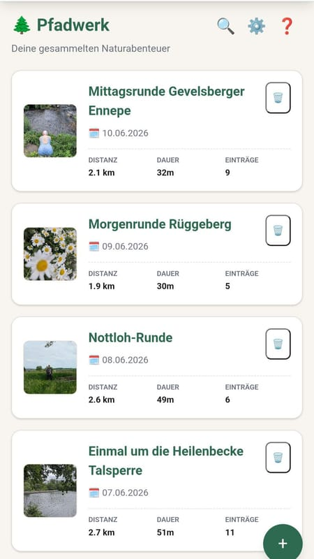
*Abb. 1: Der Startbildschirm.*

## 2. Wie es entstand — Eine ehrliche Geschichte

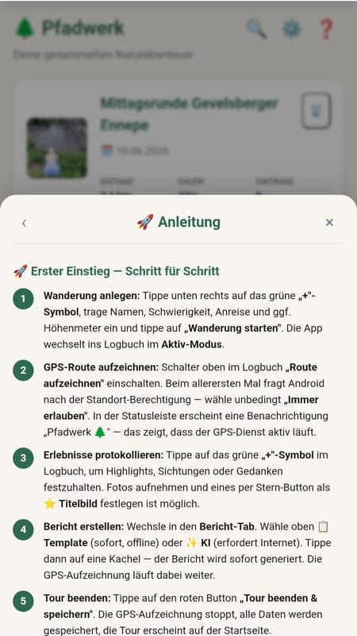
*Abb. 2: Pfadwerks vier Hauptbereiche.*

Pfadwerk ist ein Ein-Personen-Projekt, entstanden in Zusammenarbeit mit einer KI. Das klingt zunächst weniger romantisch als "ich habe das in einer Garage alleine gebaut" — ist aber die ehrlichste Beschreibung dessen, was hier passiert ist.

Die App wurde in mehreren Entwicklungs-Blöcken aufgebaut und anschließend in mehreren Feldtests auf echten Wanderungen erprobt. Die dabei gefundenen Fehler wurden akribisch protokolliert und behoben — was erklärt, warum die App in Version 4.9.53 angekommen ist, bevor sie am 22.07.2026 im Store erschien.

Seitdem geht es weiter: Eigene Touren, Rückmeldungen und neue Ideen führen zu Korrekturen und neuen Funktionen. Aktuell ist die App bei Version 4.9.80.

### Die Entwicklungs-Blöcke

Die App entstand in klar strukturierten Phasen:

- **Block A:** Grundgerüst — Touren anlegen, Logbuch, Datenspeicherung
- **Block B:** Erweiterte Funktionen — GPS, Wetter, Fotos, Berichte, Exporte
- **Block C:** Premium-Features und Code-System
- **Block D:** Play Store Compliance und Veröffentlichungsvorbereitung
- **Block E+:** Feldtest-Fixes — das, was man erst merkt, wenn man wirklich draußen ist

Pfadwerk wurde in mehreren Runden ausgiebig im echten Einsatz getestet. Jede Runde brachte neue Erkenntnisse — und neue Commits.

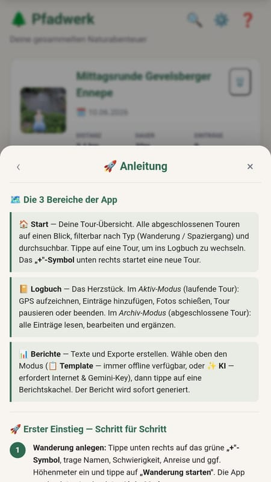
*Abb. 3: Die untere Navigationsleiste.*

### Datenspeicherung — Lokal und sicher

Die Touren und alle zugehörigen Daten werden in einer lokalen Datenbank direkt auf dem Gerät gespeichert. Man braucht kein Nutzerkonto, keine Cloud, kein Internet. Die Daten gehören ausschließlich dem Nutzer — und bleiben auf dem Gerät. Die einzige Ausnahme ist die optionale KI-Berichtsfunktion (Premium): Dabei gehen die Tourdaten und Logbuchtexte — ohne Fotos — zur Berichtserstellung an Google, mehr dazu in der [Datenschutzerklärung](index.html#datenschutz).

## 3. Technische Architektur — Für Neugierige

Wer jetzt Schaubilder mit Microservices und Event-Driven-Architecture erwartet: Tut uns leid. Pfadwerk ist stolz auf seine Schlichtheit.

### Eine Web-App im nativen Gewand

Pfadwerk ist technisch gesehen eine Web-Applikation: HTML, CSS, JavaScript. Was sie zur echten Android-App macht, ist Capacitor — ein Werkzeug, das die Web-App in eine native Android-Hülle verpackt. Man bekommt damit Zugriff auf echte Smartphone-Funktionen: GPS, Kamera, Dateisystem, Benachrichtigungen.

Das Ergebnis: Eine App, die sich nativ anfühlt, schnell ist und keinen Server braucht. Alles läuft lokal auf dem Gerät — bis auf die optionale KI-Berichtsfunktion.

**Tech-Stack**

- **Framework:** Capacitor + Vanilla JS
- **Plattform:** Android (nativ)
- **Datenspeicherung:** Lokal, KI optional online
- **GPS:** Hintergrund-Tracking
- **Version:** v4.9.80

## 4. Die Funktionen im Detail

### 4.1 Eine Tour anlegen

Am Anfang jeder Tour steht ein Tippen auf den „+"-Knopf. Ab da fragt Pfadwerk nur das Nötigste: Name, Datum, Tourentyp (Wanderung, Spaziergang oder Radtour). Alles andere lässt sich unterwegs ergänzen — oder auch gar nicht. Bei Radtouren passt Pfadwerk Berichtston und Ausrüstungsvorschläge an.

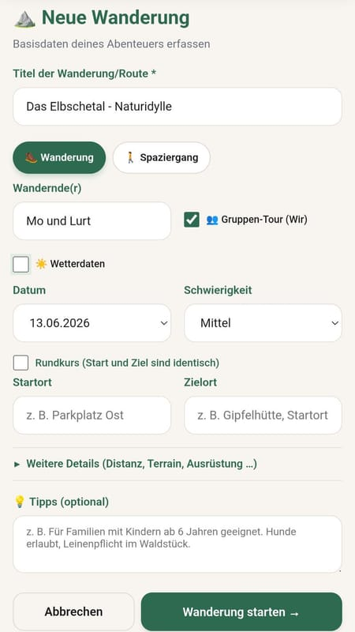
*Abb. 4: Das Tour-Formular.*

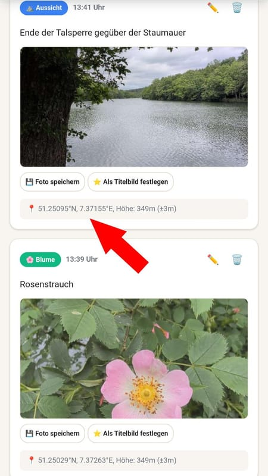
*Abb. 5: Logbuch mit GPS-Koordinaten.*

### 4.2 GPS-Aufzeichnung

Pfadwerk zeichnet die Route als GPS-Spur auf. Die App läuft dabei im Hintergrund weiter — man muss das Telefon nicht dauerhaft aufgesperrt halten. Die GPS-Spur lässt sich später als GPX-Datei exportieren und in anderen Tools öffnen.

### 4.3 Logbuch-Einträge

Das Herzstück von Pfadwerk ist das Logbuch. Unterwegs lassen sich Einträge in vier Kategorien schreiben: Highlight, Aussichtspunkt, Sichtung und Gedanke. Jeder Eintrag bekommt automatisch die aktuelle GPS-Position und die Uhrzeit mitgegeben.

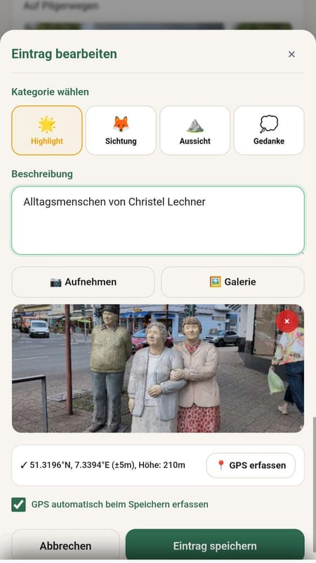
*Abb. 6: Logbuch-Eintrag mit Kamera und Kategorie.*

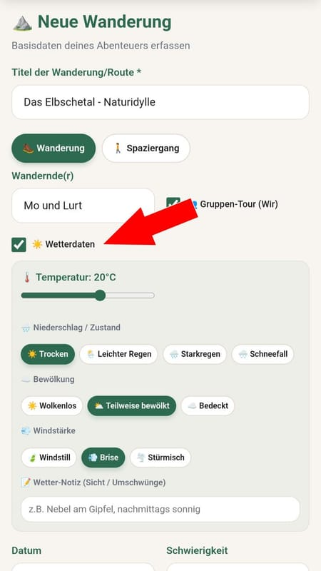
*Abb. 7: Wetterdaten.*

### 4.4 Wetter

Das Wetter ist das große Thema jeder Outdoor-Aktivität — ob man will oder nicht. Pfadwerk lässt einen das Wetter schnell erfassen: Temperatur, Bedingungen (Sonnig, Bewölkt, Regen, etc.), Wind. Einfach antippen, fertig.

### 4.5 Ausrüstung und Gelände

Was hatte man dabei? Was fehlte? Pfadwerk bietet Chip-Auswahlen für häufige Ausrüstungsgegenstände und Geländetypen. Schnelle Mehrfachauswahl per Tipp — kein Tippen erforderlich. Passend zur Jahreszeit schlägt die App außerdem Ausrüstung vor; bei Radtouren gibt es eine eigene Liste (Flickzeug, Licht, Regenjacke) statt Gamaschen und Trekkingstöcken.

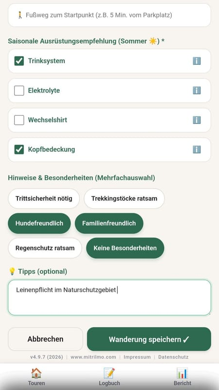
*Abb. 8: Chip-Auswahl für Ausrüstung und Terrain.*

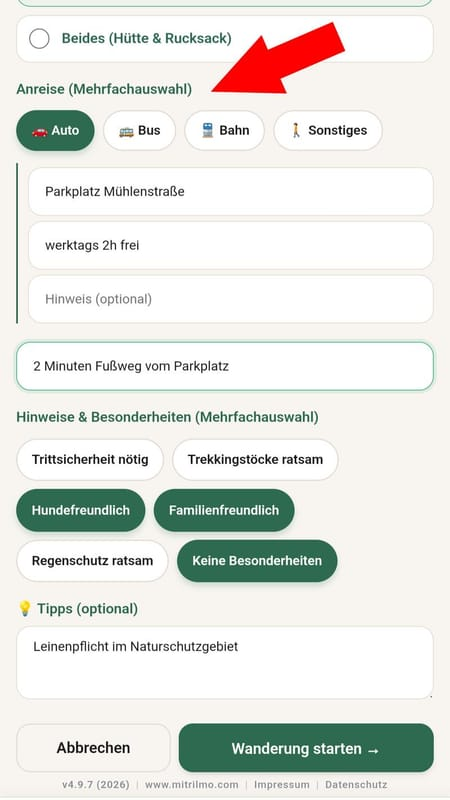
*Abb. 9: Anreise (Auto / Bus / Bahn).*

### 4.6 Anreise und Verpflegung

Wie ist man hingekommen? Auto, Bus, Bahn, oder zu Fuß gestartet? Pfadwerk dokumentiert die Anreise — inklusive nützlicher Details wie Parkplatz, Öffnungszeiten und Kosten. Auch die Verpflegung unterwegs lässt sich festhalten.

### 4.7 Fotos

Fotos lassen sich direkt aus der App heraus schießen oder aus der Galerie importieren. Beim Teilen setzt Pfadwerk sein Logo dezent unten rechts ins Foto — ohne Freischalt-Code immer, mit Code lässt es sich abschalten. Die Datensicherung sichert die Fotos dagegen ohne Logo, so wie sie in der App gespeichert sind.

Über „Mit Notiz teilen“ lässt sich eine kurze Notiz (bis 40 Zeichen) in einem weißen Rahmen unter dem Foto hinzufügen — praktisch, wenn man ein Bild direkt mit Freunden oder der Community teilt. Das Logo bleibt dabei auf dem Foto (sofern das Wasserzeichen nicht abgeschaltet ist), die Notiz wird nicht gespeichert.

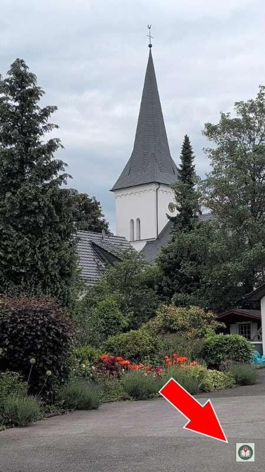
*Abb. 10: Das Pfadwerk-Logo als Wasserzeichen auf Fotos.*

### 4.8 Touren vorab planen

Eine Route ist schon im Kopf oder in einer anderen App geplant? Dann lässt sich die Tour vorab erfassen — mit Name, Start und Ziel, Datum, Anreise, Ausrüstung und Tipps, ganz ohne GPS-Start. Die Übersicht zeigt alle geplanten Touren, sie lassen sich bearbeiten oder löschen. Am Tourtag genügt ein Tipp auf „Starten“: Die Angaben sind übernommen, und die GPS-Aufzeichnung beginnt.

### 4.9 Statistik und Jahresziele

Das Statistik-Dashboard zeigt Gesamtkilometer, Anzahl der Touren, die häufigste Tourart, Rekord-Höhenmeter und eine Übersicht pro Jahr. Fürs laufende Jahr lassen sich eigene Kilometerziele setzen — getrennt für Zu-Fuß-Touren und Radtouren, denn 500 Wanderkilometer und 500 Radkilometer lassen sich schlecht vergleichen.

## 5. Berichte und Exporte

Am Ende einer Tour, wenn man wieder zuhause ist und die Wanderschuhe in der Ecke stehen, fängt der zweite Teil von Pfadwerk an: die Dokumentation.

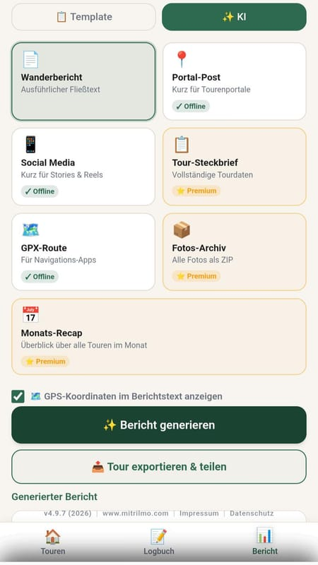
*Abb. 11: Berichte Tab (Template / KI).*

### 5.1 Automatisch generierte Berichte

Pfadwerk erstellt aus den erfassten Daten automatisch Berichte in drei Varianten:

- **Langer Bericht:** Vollständige Dokumentation aller Daten
- **Kurzer Bericht:** Kompakter Überblick, ideal zum Teilen
- **Social-Media-Post:** Fertig formuliert für Instagram & Co.

### 5.2 Exporte

- **HTML-Export (Premium):** Vollständiger Blog-Beitrag als HTML-Datei — mit Fotos, GPS-Daten und formatiertem Text
- **GPX-Export:** GPS-Spur im Standardformat für Navi-Apps und Komoot
- **TXT-Export:** Alle Daten als einfache Textdatei
- **PDF-Export (Premium):** Fertig formatierter Bericht zum Ausdrucken oder Weitergeben — mit den Fotos neben dem Text in zwei Spalten
- **Sharepic (Premium):** Bild mit Routen-Silhouette und den wichtigsten Zahlen einer Tour, zum Teilen

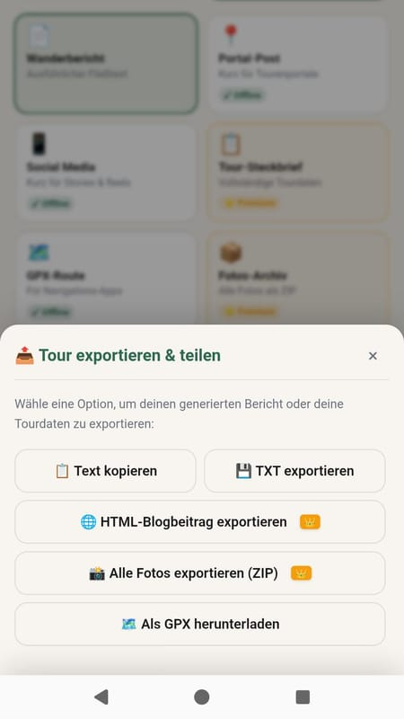
*Abb. 12: GPX-, HTML- und TXT-Export.*

### 5.3 Datensicherung

Weil alle Daten nur auf dem Gerät liegen, gibt es eine Datensicherung. Sie wird von Hand angestoßen — ein automatisches Backup oder eine Cloud gibt es nicht.

In den Einstellungen lassen sich alle Touren und Logbucheinträge als Datei sichern. Die Fotos werden getrennt gesichert, auf Wunsch monatsweise, damit die Dateien handlich bleiben. Sie enthalten kein Logo und sind so, wie sie in der App gespeichert sind — für alle Nutzer, auch ohne Premium.

Beim Zurückspielen ergänzt Pfadwerk vorhandene Touren, statt sie zu überschreiben oder doppelt anzulegen; die Fotos werden danach aus der Fotosicherung wiederhergestellt. Geplante Touren und Einstellungen sind nicht Teil der Sicherung.

## 6. Premium-Funktionen

Pfadwerk ist kostenlos, und die Premium-Funktionen sind für alle offen: Der Freischalt-Code steht hier und wechselt jeden Monat. Kein Abo, kein Kauf im Store, keine Anmeldung, keine automatischen Verlängerungen — den Code einfach in der App eingeben.

Zum Anzeigen des Codes wird JavaScript benötigt.

Eingeben in der App unter **Einstellungen → Premium → Freischalt-Code**. Der Code gilt für den laufenden Monat (mit ein paar Tagen Kulanz), danach sperrt die App die Premium-Funktionen wieder — dann den neuen Code eingeben, der am Monatsersten hier steht. Groß- und Kleinschreibung sowie Bindestriche sind egal.

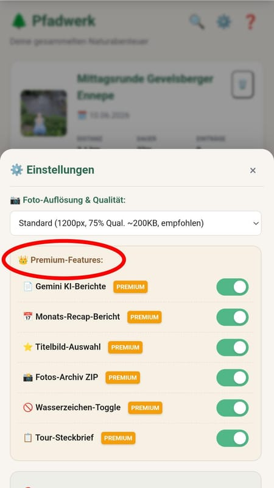
*Abb. 13: Premium Features in den Einstellungen.*

- KI-Wanderbericht mit Gemini (eigener kostenloser Schlüssel, braucht Internet)
- HTML-Blogbeitrag und PDF-Export
- Monats-Recap: alle Touren eines Monats in einem Bericht
- Titelbild für jede Tour frei wählbar
- Fotos einer Tour als ZIP exportieren
- Sharepic zu jeder Tour mit Routen-Silhouette
- Wasserzeichen beim Teilen von Fotos abschaltbar

Ohne Code nutzbar sind unter anderem Statistik-Dashboard, Jahresziele, Datensicherung und „Mit Notiz teilen“.

### KI-Reisebericht

Die bemerkenswerteste Premium-Funktion: Pfadwerk kann aus den erfassten Daten mit Hilfe von Gemini einen vollständigen, lesbaren Wanderbericht generieren. Kein Copy-Paste, kein Nachbearbeiten — einfach tippen und lesen. Dafür braucht es einen eigenen, kostenlosen Google-Schlüssel (Google AI Studio) und eine Internetverbindung. Die Tourdaten und Logbuchtexte gehen dabei — ohne Fotos — an Google, mehr dazu in der [Datenschutzerklärung](index.html#datenschutz).

Der KI-Bericht landet direkt im HTML-Export und kann sofort auf einer Website veröffentlicht werden.

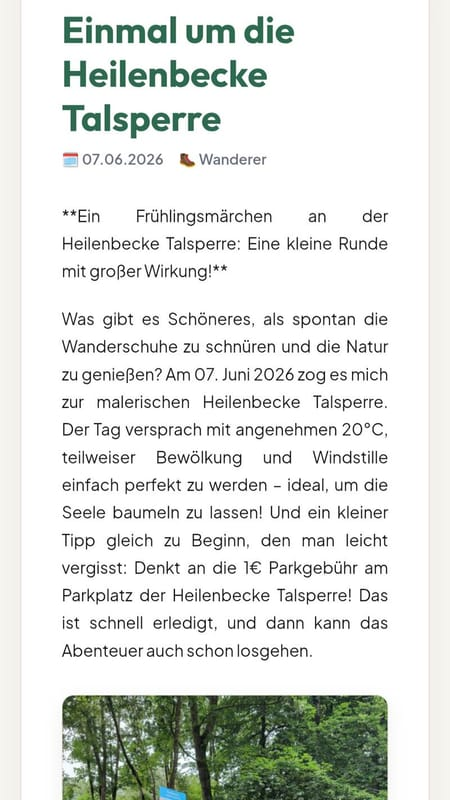
*Abb. 14: Ein von Gemini erstellter Reisebericht.*

## 7. Komfort-Funktionen

### 7.1 Easy-Modus

Für alle, die eine etwas größere Schrift bevorzugen: Pfadwerk bietet einen Easy-Modus, der alle Texte und Schaltflächen vergrößert — ohne das Layout zu zerstören.

### 7.2 Tipps & Tricks

Eine eingebaute Hilfe-Sektion erklärt die wichtigsten Funktionen mit kurzen, praxisnahen Tipps. Direkt in der App, ohne externe Links.

### 7.3 Pfadwerk weiterempfehlen

In den Einstellungen zeigt ein QR-Code den Store-Eintrag der App — praktisch, um Pfadwerk unterwegs direkt jemandem zu zeigen.

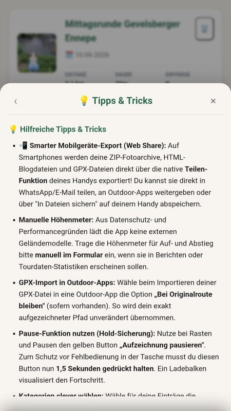
*Abb. 15: Tipps & Tricks in der App.*

## 8. Ausblick

Seit dem 22.07.2026 ist Pfadwerk im Google Play Store zu finden. Was bis dahin an formalen Schritten nötig war — Compliance-Anforderungen von Google, Datenschutz-Nachweise, Release-Builds — ist erledigt.

Seitdem geht die Entwicklung weiter. Entstanden sind unter anderem geplante Touren, die Tourart Radtour, das Statistik-Dashboard mit Jahreszielen, die monatsweise Foto-Sicherung und „Mit Notiz teilen“. Die Grundlage ist stabil und mehrfach feldgetestet — fertig ist so eine App aber nie ganz.

Pfadwerk ist aktuell eine reine Android-App und läuft nicht auf iOS-Geräten (iPhone/iPad). Eine iOS-Version ist derzeit nicht geplant.

Parallel dazu reifen bereits weitere Ideen in der "Werk"-Familie. Vielleicht wird Pfadwerk dereinst Gesellschaft bekommen. Oder auch nicht. Manchmal ist ein gut gemachtes Ding für sich genug.

[Jetzt im Google Play Store ↗](https://play.google.com/store/apps/details?id=com.mitrilmo.pfadwerk)

**Aktueller Stand**

- **Version:** v4.9.80 — laufend weiterentwickelt, mehrfach feldgetestet
- **Status:** Seit 22.07.2026 im Google Play Store
- **Entstanden:** Als Ein-Personen-Projekt mit KI-Unterstützung
- **Plattform:** Android (kein iOS)

Alle Screenshots auf dieser Seite sind Beispiele aus dem Versionsverlauf und können sich in aktuellen Versionen leicht anders darstellen.

„Der schönste Weg ist der, der einen zurückkommen lässt."

Pfadwerk merkt sich den Weg.
