Was für ein grandioser Wandertag am 23. August 2026! Wir, Mo & Ursel & Wanderbuddies, haben uns auf den 3-Türme-Weg in Hagen gewagt und sind restlos begeistert. Schon am Morgen versprach das Wetter eine perfekte Tour: Mit angenehmen 14 Grad, trockenem Terrain und einer erfrischenden Brise, die ab und an durch die teilweise bewölkten Himmel zog, war es ideal für unser Abenteuer.

Wir starteten unsere Rundwanderung am Stadtgarten Hagen, wo wir unser Auto bequem und mit einem praktischen Wander-Parkticket sogar fünf Stunden kostenfrei abstellen konnten. Kaum waren wir auf dem Weg, wurden wir schon um 09:22 Uhr mit einem ersten atemberaubenden Panorama von Hagen belohnt. Die Stadt lag uns zu Füßen, ein wunderbarer Auftakt!

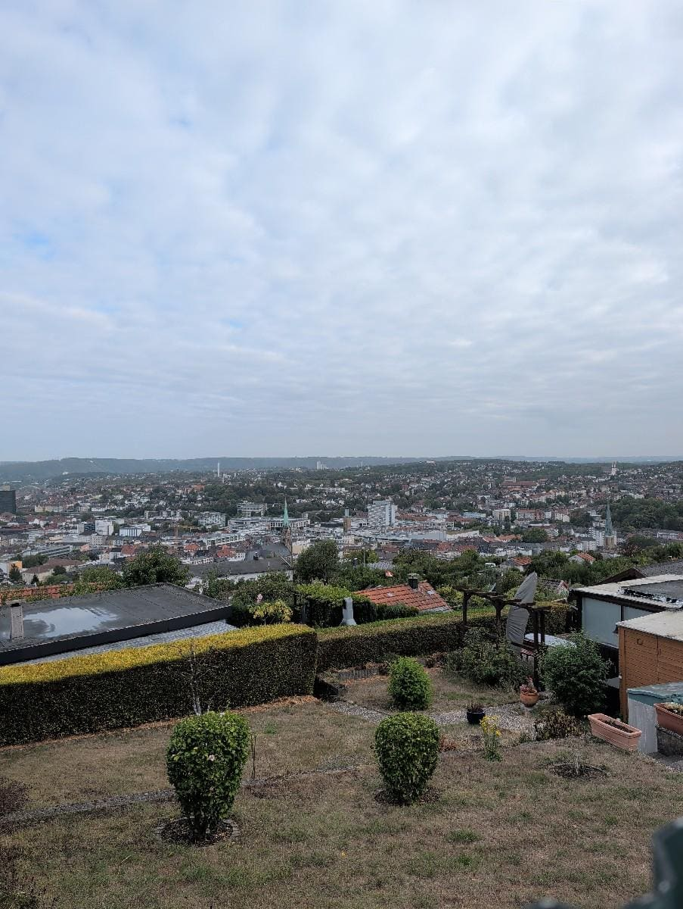
*Panorama Hagen*

Wenige Minuten später, um 09:37 Uhr, erreichten wir den imposanten Bismarckturm, ein echtes Wahrzeichen und ein fantastischer Aussichtspunkt.

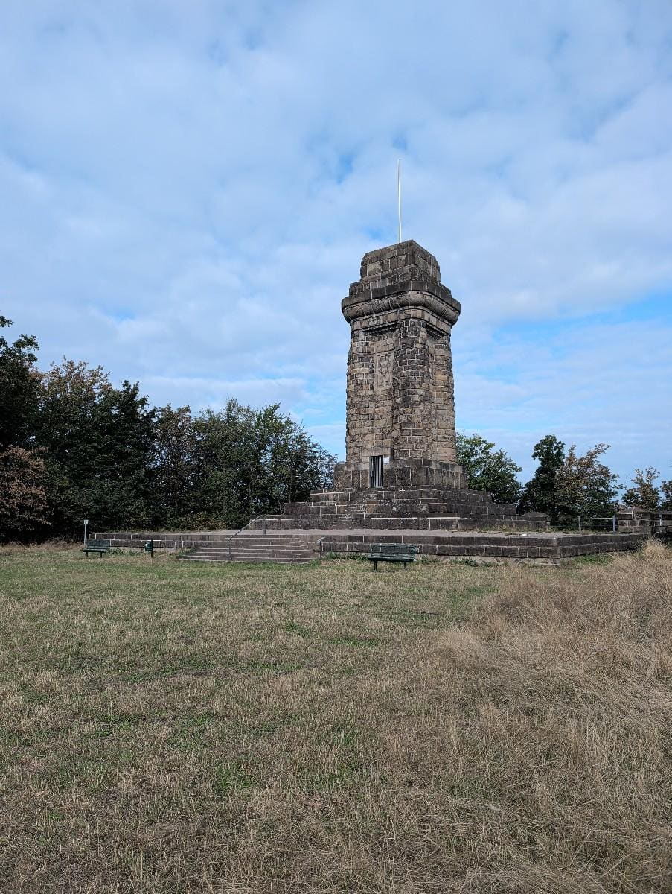
*Der Bismarckturm*

Die Begeisterung wuchs, als wir um 09:57 Uhr die ehemalige Skiliftanlage von Hagen passierten – ein spannender Blick in vergangene Zeiten und gleichzeitig eine tolle Aussicht.

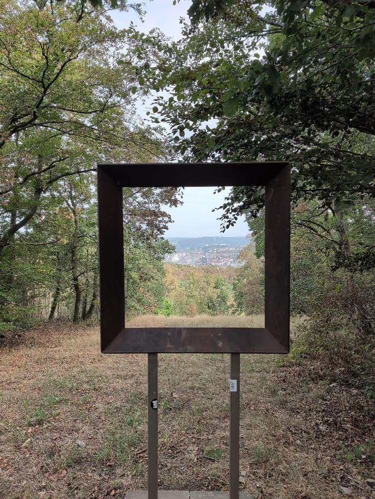
*Ehemalige Skiliftanlage von Hagen*

Gegen 10:11 Uhr stellten wir wieder einmal fest, dass wir eine wirklich lustige Wandertruppe sind, die einfach das Draußensein in vollen Zügen genießt. Kurz darauf, um 10:24 Uhr, sorgte eine beeindruckende Spechtskulptur für ein charmantes Detail am Wegesrand, das uns schmunzeln ließ.

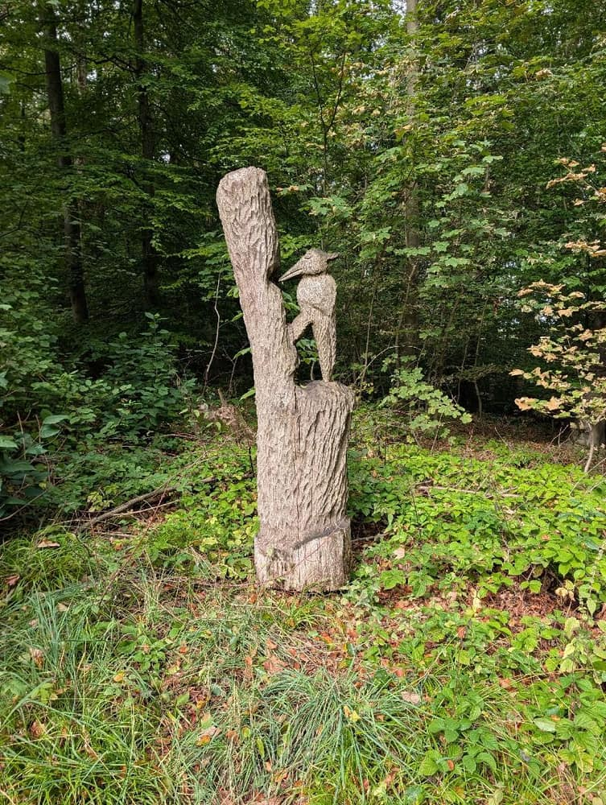
*Spechtskulptur*

Der 3-Türme-Weg zeigte sich als perfekt ausgeschildert, was uns um 10:55 Uhr besonders positiv auffiel und die Orientierung zum Kinderspiel machte. Der Pfad wechselte zwischen festen Schotterwegen und weichen Waldpfaden, was die Wanderung abwechslungsreich hielt und die Beine schont.

Gegen 12:11 Uhr erwartete uns ein doppelter Genuss: ein spektakulärer Blick ins Sauerland und der majestätische Kaiser-Friedrich-Turm. Was für eine schöne Aussicht!

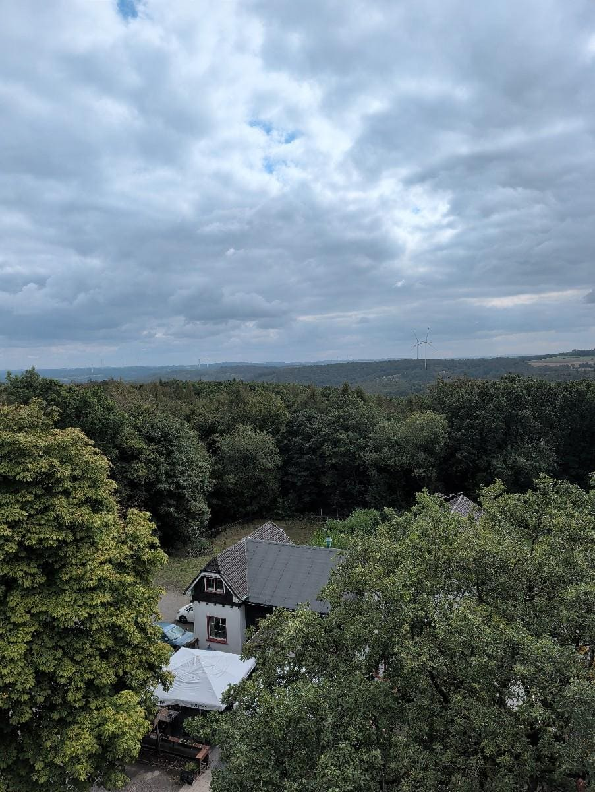
*Blick ins Sauerland*

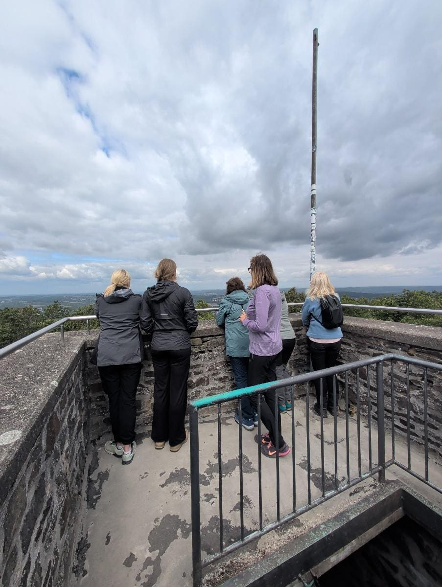
*Schöne Aussicht und Kaiser-Friedrich-Turm.*

Um 12:34 Uhr führte uns der Weg tief in den schattigen Wald hinein, eine willkommene Abkühlung und eine Wohltat für die Sinne. Hier konnten wir die Natur in vollen Zügen genießen.

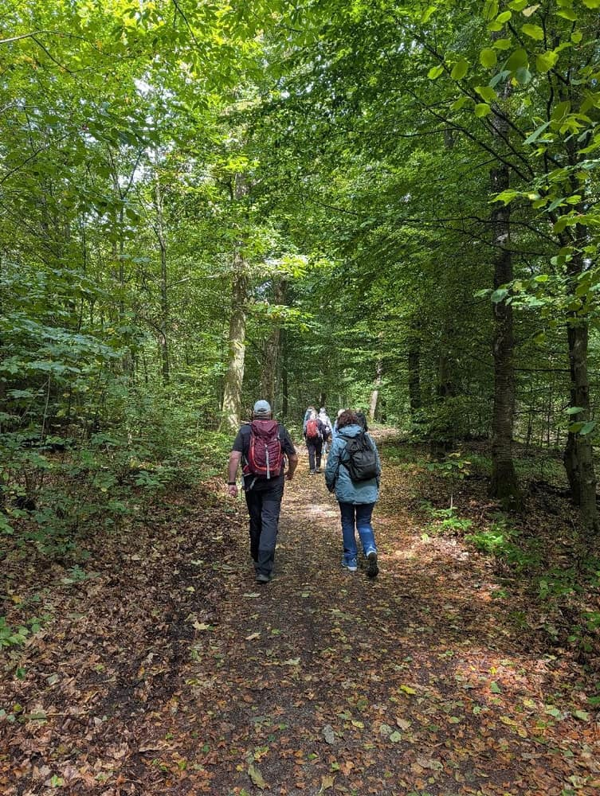
*Wir gehen ganz viel durch den schattigen Wald*

Kurz nach 13:00 Uhr häuften sich die Highlights: Um 13:03 Uhr bestaunten wir die kunstvolle Schnitzwand und gleichzeitig den imposanten Eugen Richter Turm.

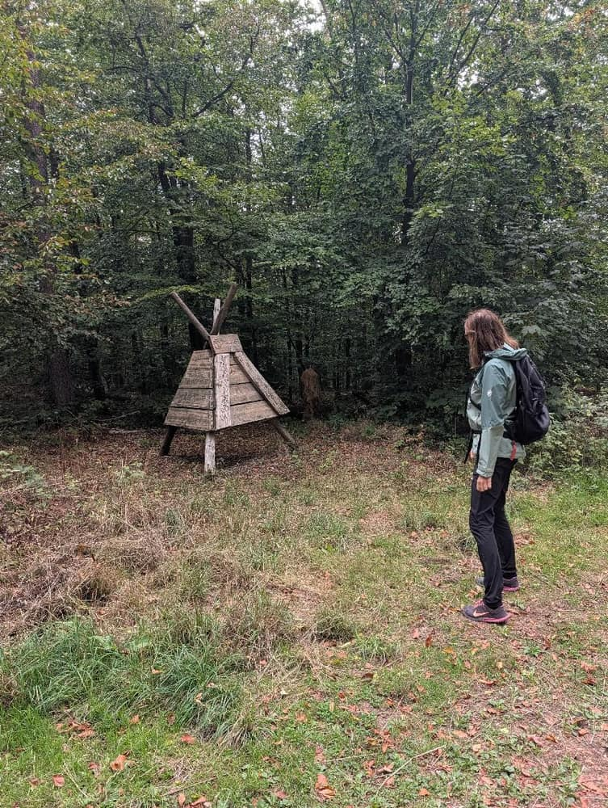
*Schnitzwand*

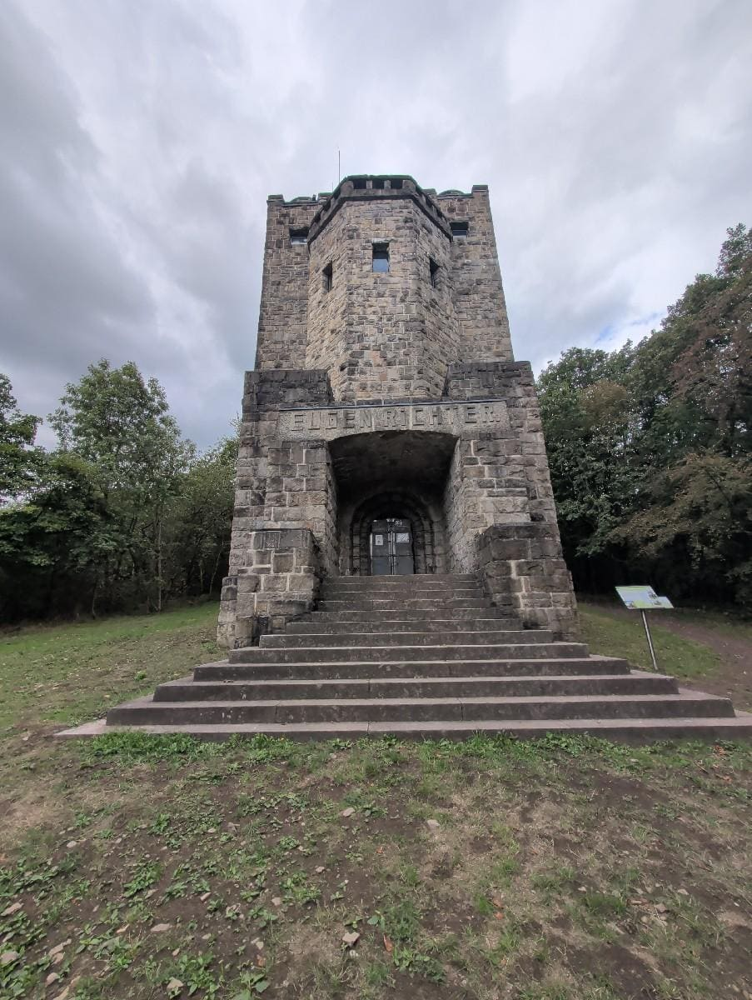
*Der Eugen Richter Turm*

Nur zwei Minuten später, um 13:05 Uhr, passierten wir die faszinierende Hagener Sternwarte.

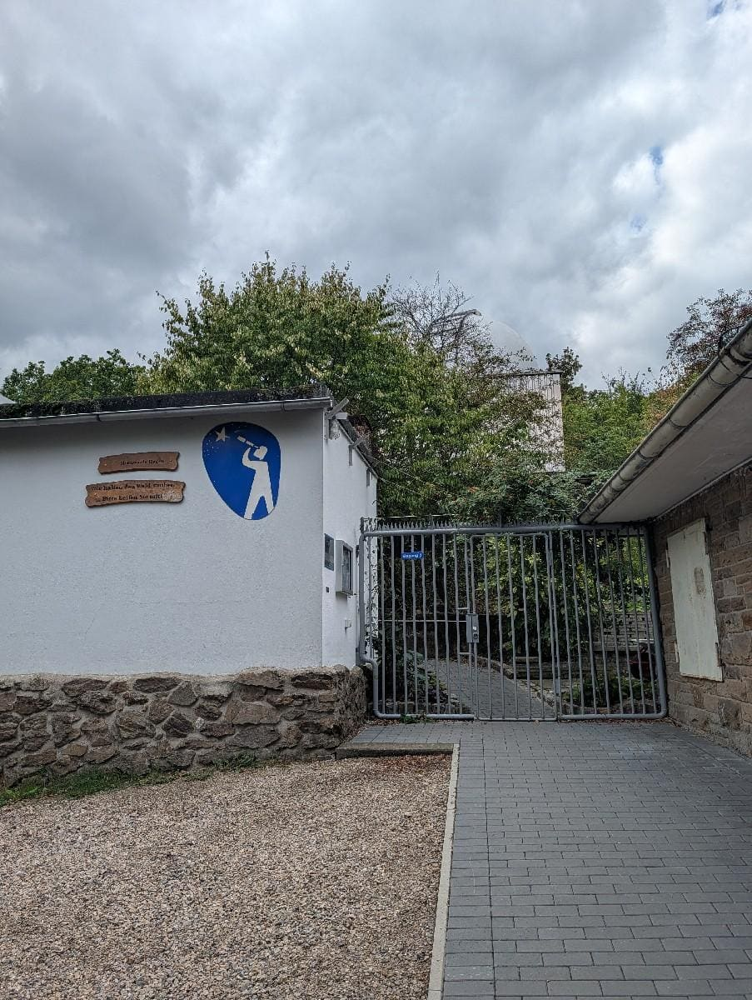
*Hagener Sternwarte*

Ein weiteres Panorama von Hagen eröffnete sich uns um 13:18 Uhr, das wir in vollen Zügen genossen.

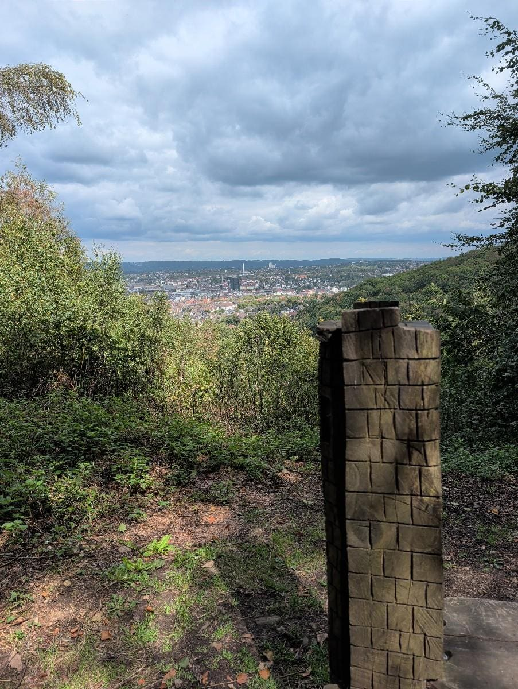
*Panorama Hagen*

Um 13:39 Uhr erreichten wir die Waldlust, ein ehemaliges Ausflugslokal, das 2026 leider noch geschlossen war – wir hoffen, es erwacht bald wieder zum Leben!

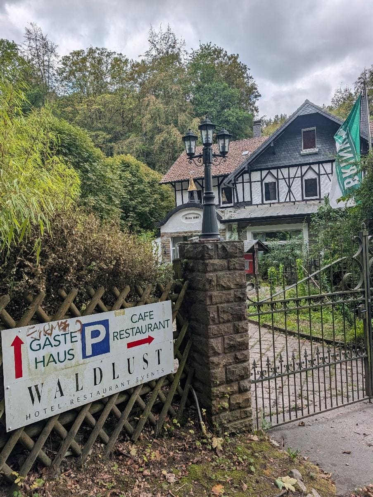
*Die Waldlust (ein ehemaliges Ausflugslokal, das derzeit leider geschlossen is...*

Den krönenden Abschluss bildete um 13:54 Uhr das Aussichtsguckloch Hawker, ein kleiner, aber feiner Blickfang.

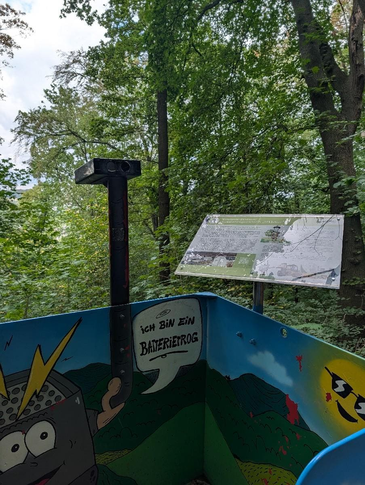
*Aussichtsguckloch Hawker*

Dieser Weg ist nicht nur für uns Wanderbuddies ein Traum, sondern dank seiner guten Beschaffenheit auch super hundefreundlich und familientauglich – perfekt für einen gemeinsamen Ausflug. Und wer unterwegs eine Stärkung braucht, findet entlang der Strecke sogar eine Hütte oder ein Gasthaus.

Dieser 3-Türme-Weg hat uns restlos begeistert und wir können ihn jedem nur wärmstens empfehlen! Die Kombination aus abwechslungsreicher Natur, historischen Türmen und immer wieder grandiosen Ausblicken macht ihn zu einem unvergesslichen Erlebnis.

Voller Wanderlust und mit besten Grüßen an die Community,\
Mo & Ursel & Wanderbuddies! 🥾🌲

---

**Statistik zum 3-Türme-Weg Hagen**

- Name: 3-Türme-Weg Hagen
- Datum: 23.08.2026
- Start/Ziel: Stadtgarten Hagen (Rundweg)
- Typ: Wanderung
- Länge: 10,8 km
- Dauer: 4 Stunden 56 Minuten
- Schwierigkeit: Mittel
- Gelände: Schotterweg, Waldweg
- Verpflegung: Ja, mit Hütte/Gasthaus
- Ausrüstungsempfehlung: Trinksystem, Kopfbedeckung
- Wetter: 14°C, Trocken, Teilweise bewölkt, Brise
