Was für ein Tag! Am 7. Juni 2026 zog es mich mal wieder raus in die Natur, und diesmal stand die Heilenbecke Talsperre auf dem Programm. Schon die Anfahrt mit dem Auto war entspannt, und als ich am Parkplatz ankam, empfing mich ein herrlicher Tag. Bei angenehmen 20 Grad, trockenem Wetter, nur teilweise bewölktem Himmel und absoluter Windstille – das sind doch die perfekten Bedingungen für eine kleine Auszeit vom Alltag! Ich wusste sofort: Das wird gut!

Bevor ich aber richtig loslegen konnte, gab es noch einen wichtigen Stopp: die Infotafel zur Talsperre. Ich liebe es, ein bisschen Hintergrundwissen zu sammeln, bevor ich in die Landschaft eintauche.

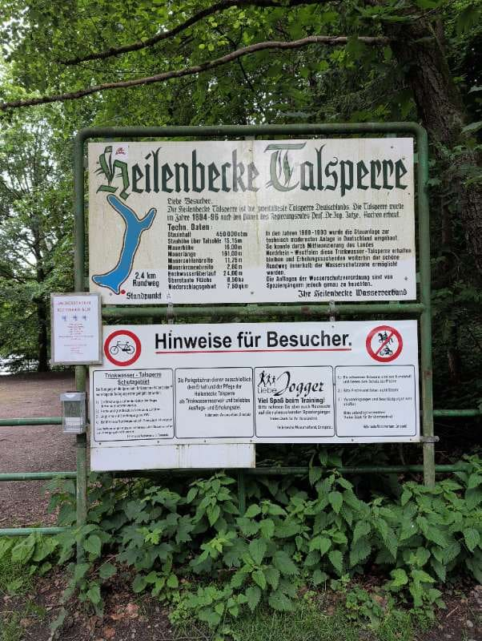
*Infotafel Tür Talsperre*

Und kaum war ich informiert, stand ich auch schon direkt vor der imposanten Staumauer. Eine echte Bruchsteinmauer nach dem Intze-Prinzip – beeindruckend, wie so etwas vor langer Zeit gebaut wurde.

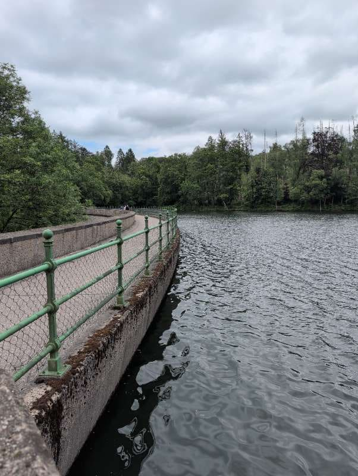
*Staumauer (Bruchsteinmauer nach dem Intze-Prinzip)*

Der Weg schlängelte sich sogleich wunderschön am Wasser entlang. „Super Wanderwege!“, dachte ich mir sofort, und dieses Gefühl sollte mich die ganze Zeit begleiten.

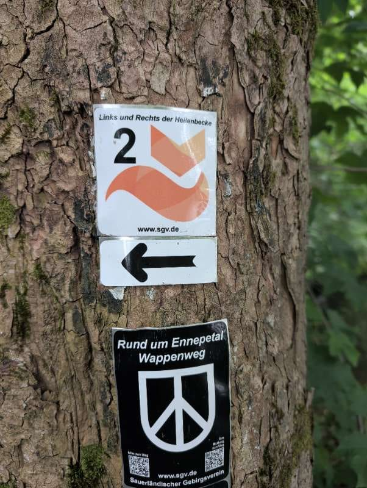
*Super Wanderwege*

Der Blick über das spiegelglatte Wasser war einfach nur magisch. So friedlich, so klar – genau das, was die Seele braucht.

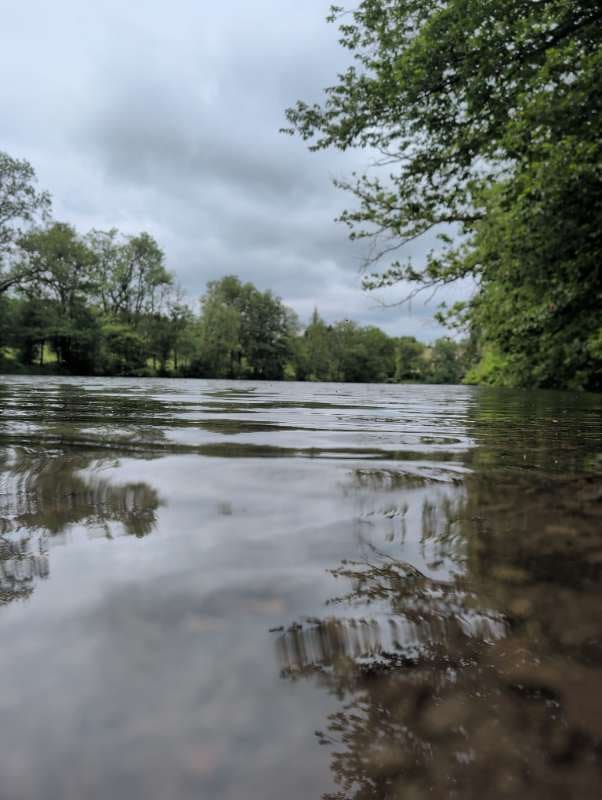
*Blick übers Wasser*

Und schon entdeckte ich am Ufer eine kleine Gesellschaft: Kanada- und Nilgänse zogen majestätisch ihre Bahnen. Ein toller Anblick!

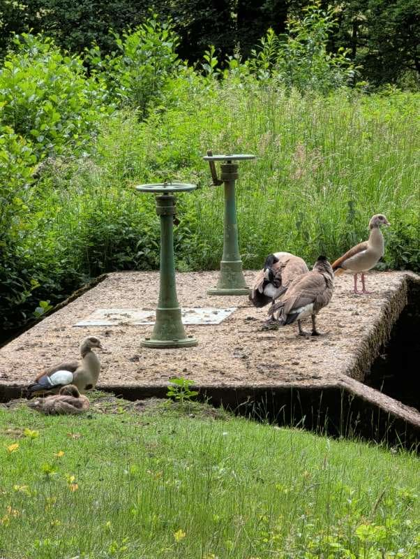
*Gänse (Kanada- und Nilgänse)*

Ein Stück weiter erfreute mich ein blühender Rosenstrauch mit seiner Farbenpracht. Die Natur zeigt sich hier wirklich von ihrer schönsten Seite.

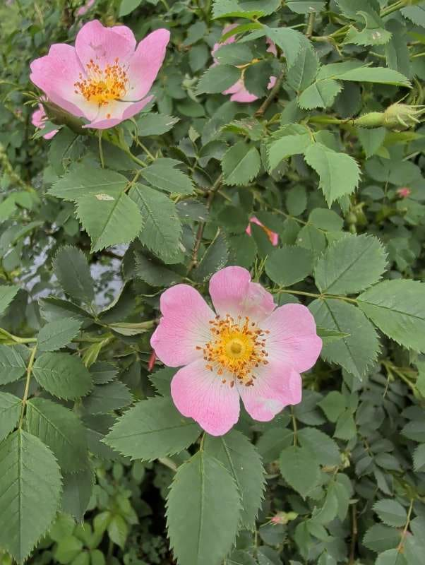
*Rosenstrauch*

Ich erreichte das Ende der Talsperre, direkt gegenüber der Staumauer, von wo aus man noch einmal einen ganz anderen, weitläufigen Blick über das gesamte Gewässer hatte.

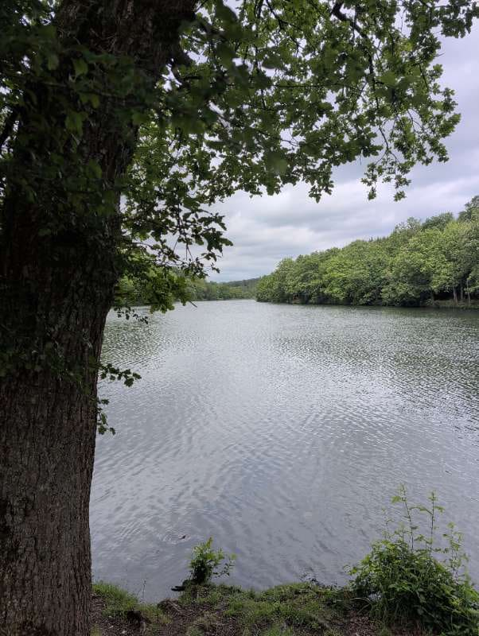
*Ende der Talsperre gegüber der Staumauer*

Der Rückweg führte mich dann durch einen traumhaft schönen Waldweg. Das Licht spielte durch die Blätter, die Luft war frisch und klar. Ein Genuss für alle Sinne. „Schöner Weg durch den Wald“, notierte ich gedanklich.

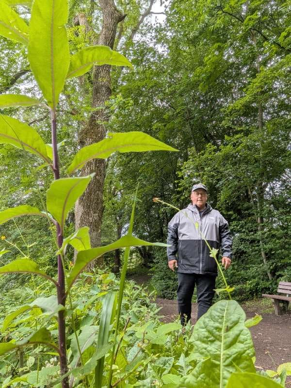
*Schöner Weg durch den Wald*

Und ehe ich mich versah, hatte ich wieder einen tollen Blick auf die Staumauer, diesmal aus einer anderen Perspektive.

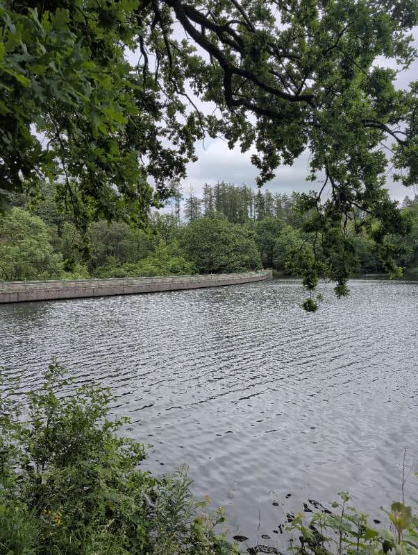
*Ein Blick auf die Staumauer*

Als aufmerksamer Wanderer entging mir auch nicht die kleine Pilzfamilie, die am Wegesrand thronte. Ein kleines, aber feines Detail der Waldflora.

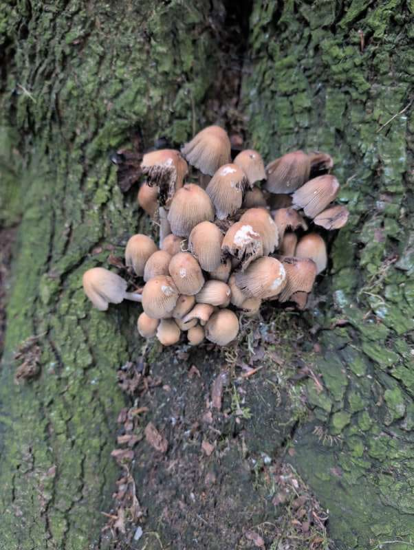
*Pilze*

Wieder am Parkplatz angekommen, erinnerte ich mich noch an die Parkgebühr von 1€ – kleines Geld für so viel Naturerlebnis!

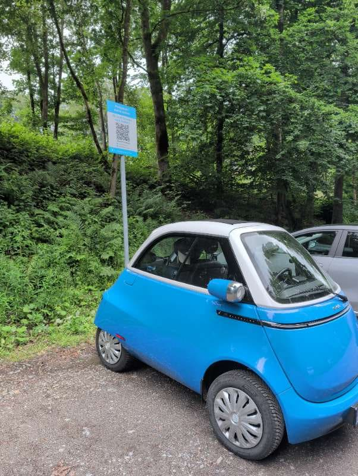
*Parkgebühr 1€ (bezahlen nicht vergessen)*

Was für eine wunderbare, familien- und hundefreundliche Runde! Die Heilenbecke Talsperre ist definitiv ein kleines Juwel für eine entspannte Auszeit, die ich jedem nur wärmstens empfehlen kann. Nur 2,66 Kilometer, perfekt für eine kleine Erholung oder einen Spaziergang mit den Liebsten!

---

**Wander-Statistiken:**

- **Tourname:** Einmal um die Heilenbecke Talsperre
- **Datum:** 07.06.2026
- **Start/Ziel:** Parkplatz Heilenbecke Talsperre
- **Distanz:** 2,66 km
- **Dauer:** 51 Minuten
- **Höhenmeter:** 10 m Aufstieg / 10 m Abstieg
- **Schwierigkeit:** Leicht
- **Terrain:** Waldweg
- **Verpflegung:** Nur Rucksackverpflegung
- **Besonderheiten:** Hundefreundlich, Familienfreundlich
- **Anreise:** Auto
- **Wetter:** 20°C, Trocken, Teilweise bewölkt, Windstill
