## Ein Elbschetal-Märchen: Wo die Natur noch wild ist und die Seele atmet!

Liebe Wanderfreunde, liebe Naturliebhaber!

Der 14. Juni 2026 – ein Datum, das sich tief in unsere Wanderherzen gebrannt hat! Mo, Lurt und unser vierbeiniger Wandergefährte Möter haben uns heute auf eine unvergessliche Reise durch das Elbschetal entführt, genauer gesagt auf den Elbschetal Rundweg. Schon die Vorhersage war vielversprechend: Trocken, teilweise bewölkt, eine leichte Brise und angenehme 16 Grad – einfach perfekt, um die Seele baumeln zu lassen und die Natur in vollen Zügen zu genießen.

Unser Abenteuer begann am Parkplatz beim Hotel Henriette Davidis, von wo aus wir nach nur fünf Minuten Fußweg zum Startpunkt Im Schleppkotten Wengern gelangten. Und was sollen wir sagen? Gleich zu Beginn wurden wir von einem Bauwerk begrüßt, das uns den Atem verschlug: Das imposante Elbschetal Viadukt! Eine beeindruckende Ingenieursleistung, die sich majestätisch in die Landschaft einfügt.

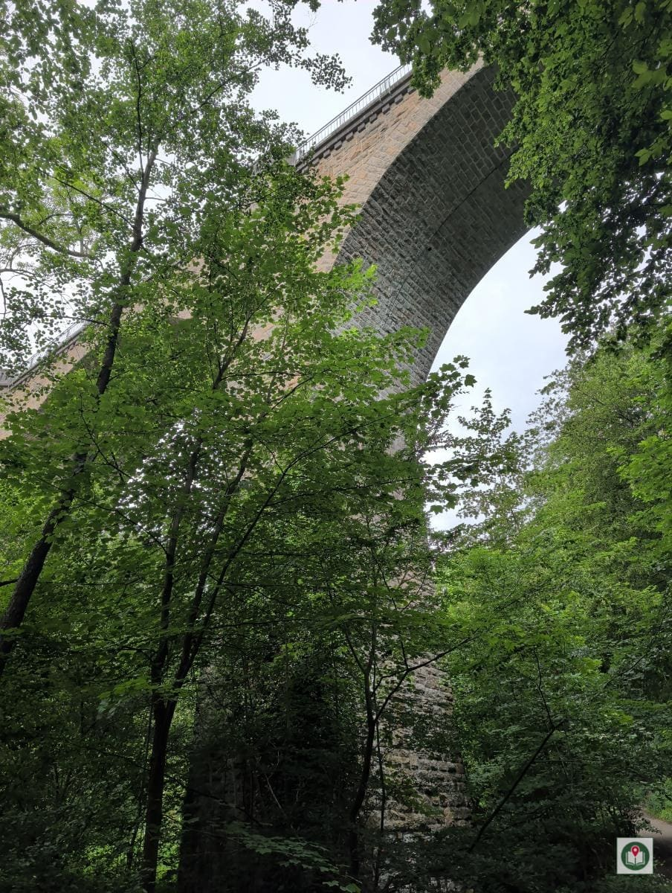
*Elbschetal Viadukt*

Der Weg führte uns weiter, ein bunter Mix aus befestigten Wegen, knackigen Schotterpassagen und urigen Waldpfaden, die Trittsicherheit erforderten, aber stets ein Lächeln auf unsere Gesichter zauberten. Überall gab es etwas zu entdecken! Um 10:20 Uhr staunten wir über einen prächtigen Käfer, der gemächlich seinen Weg kreuzte – ein kleiner Gruß aus der Fauna des Tals.

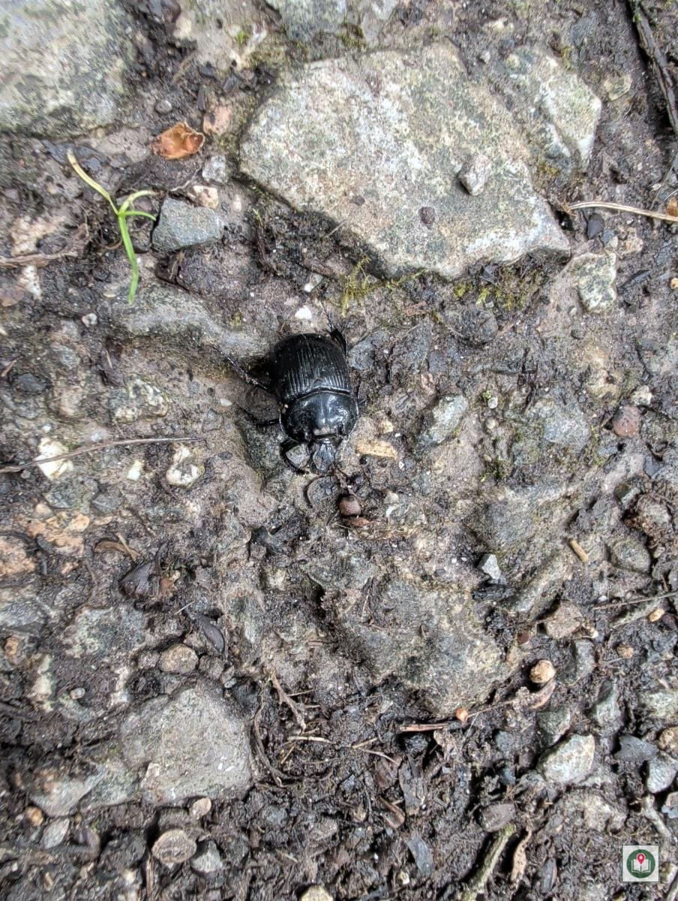
*Käfer*

Nur wenige Minuten später erreichten wir die namensgebende Elbsche, die sich sanft und klar durch das Tal schlängelt. Ein wahrhaft idyllischer Anblick.

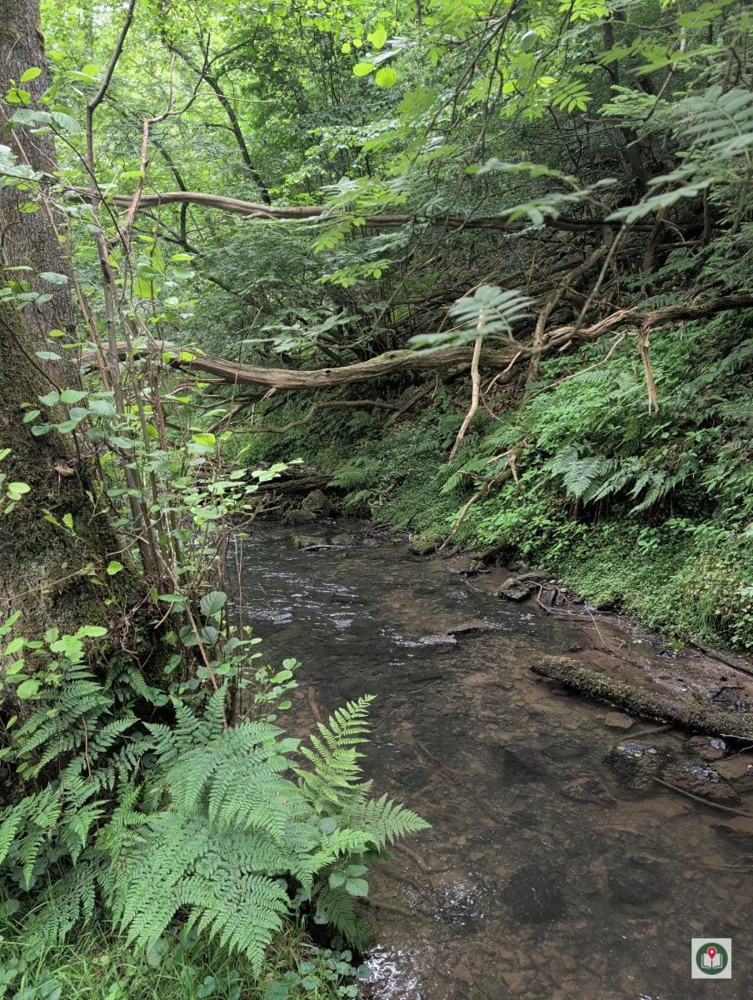
*Die Elbsche*

Dann kam ein echtes Highlight für Möter und uns: Ein kleiner Tunnel, der uns das Gefühl gab, in eine andere Welt einzutauchen – mystisch und aufregend!

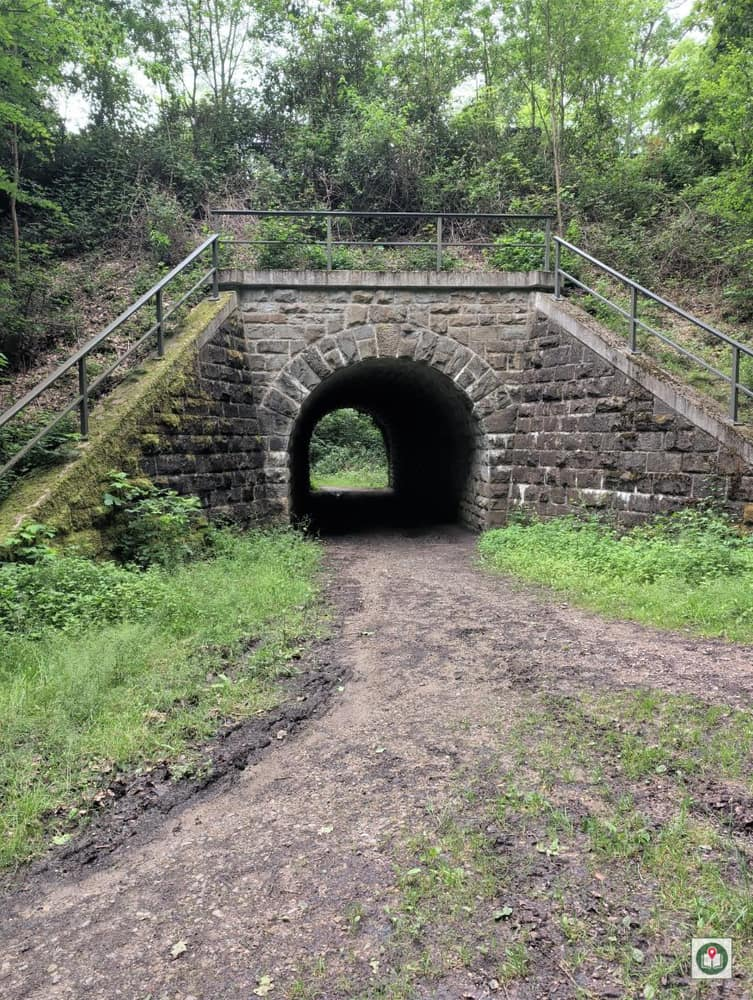
*Kleiner Tunnel*

Kaum hatten wir den Tunnel hinter uns gelassen, dachten wir fast synchron: "Wie im Urwald hier!" Dichte Vegetation, das Rauschen der Blätter und die Stille, die nur vom Vogelgezwitscher unterbrochen wurde, ließen uns die Zeit vergessen.

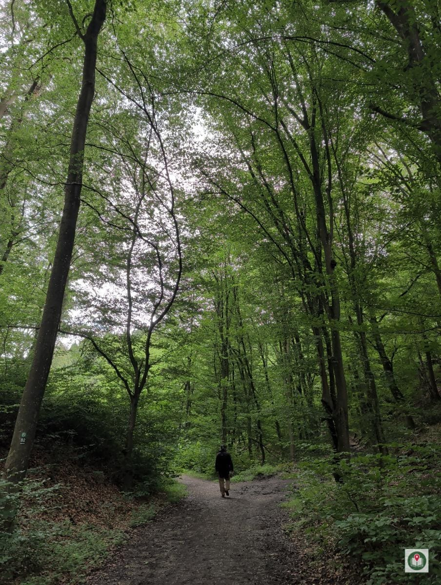
*Wie im Urwald hier.*

Nach einigen Anstiegen wurden wir um 10:53 Uhr mit einem atemberaubenden Blick über's Tal belohnt. Die Weite und Schönheit der Landschaft raubten uns schier den Atem.

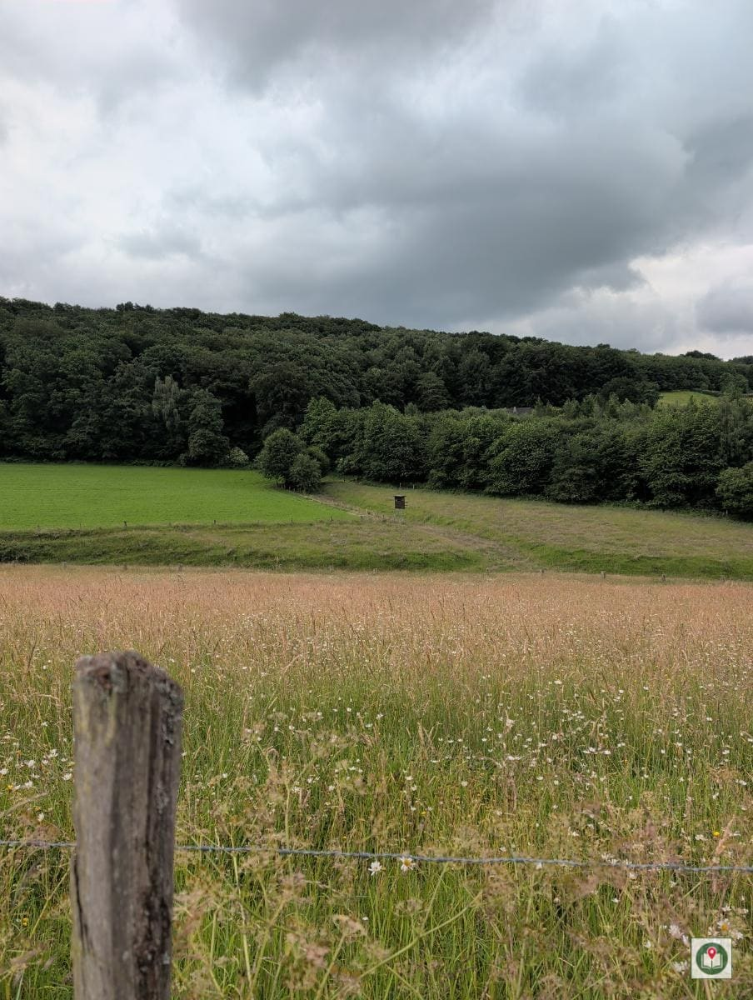
*Blick über's Tal*

Auch kulturell gab es einiges zu bestaunen. Uns fielen um 11:38 Uhr einige Gebäude mit untypischer Bergischer Architektur auf, die zum Nachdenken anregten. Weiter ging es zum historischen Schalthaus Albringhausen und nur kurz darauf zum Alten Bahnhof Albringhausen – Zeugen einer längst vergangenen Zeit, die Geschichten zu erzählen scheinen.

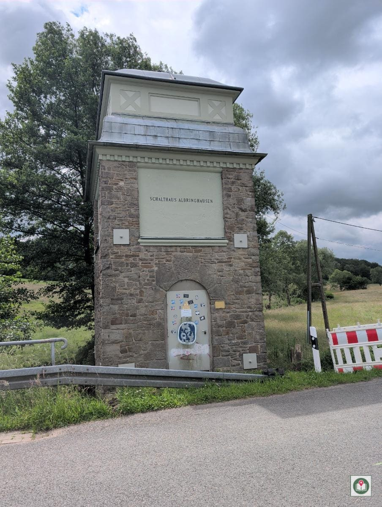
*Schalthaus Albringhausen*

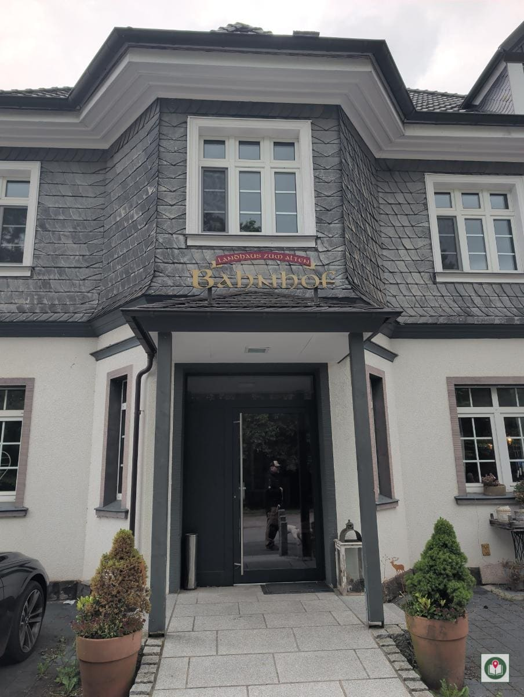
*Alter Bahnhof Albringhausen*

Der Weg ging, wie es sich für eine gute Wanderung gehört, immer wieder rauf und runter. Diese stetigen Wechsel sorgten dafür, dass es nie langweilig wurde. Um 14:28 Uhr stießen wir auf ein weiteres Stück Geschichte: die Ratelbecke aus dem Jahr 1772.

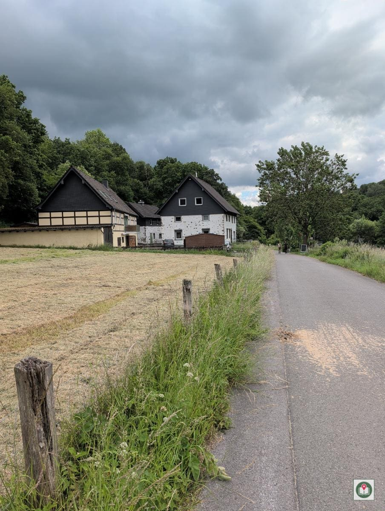
*Ratelbecke 1772*

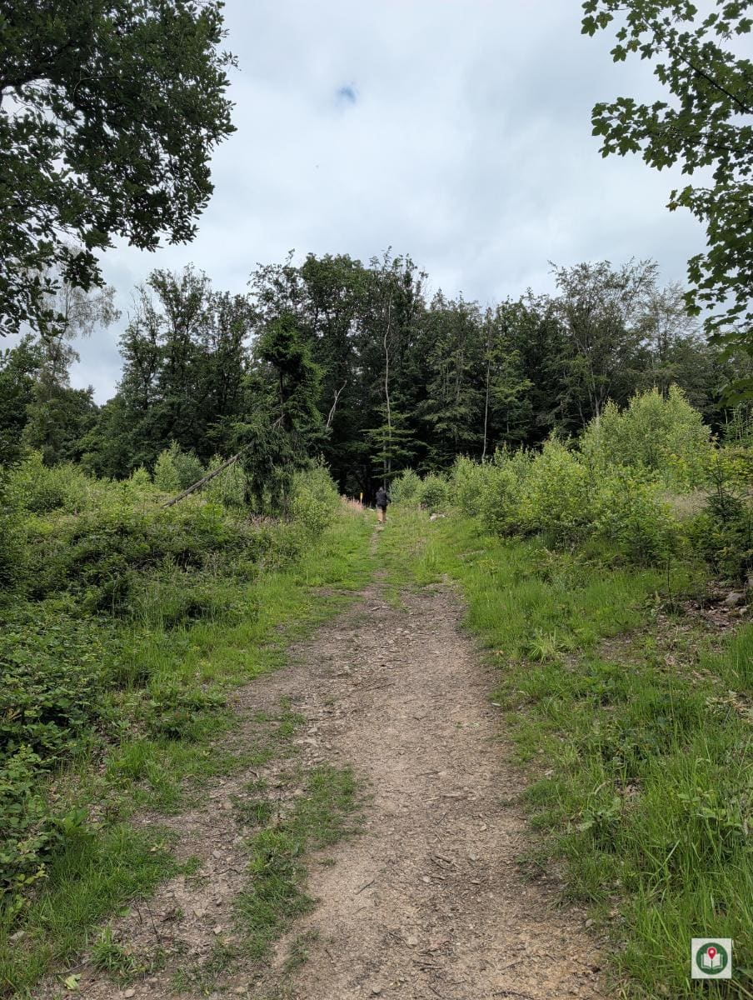
*Rauf und runter immer wieder*

Auf dem letzten Abschnitt unseres Rundwegs entdeckten wir um 14:45 Uhr wunderschönen Fingerhut, der leuchtend am Wegesrand stand und uns noch einmal die Farbenpracht der Natur vor Augen führte.

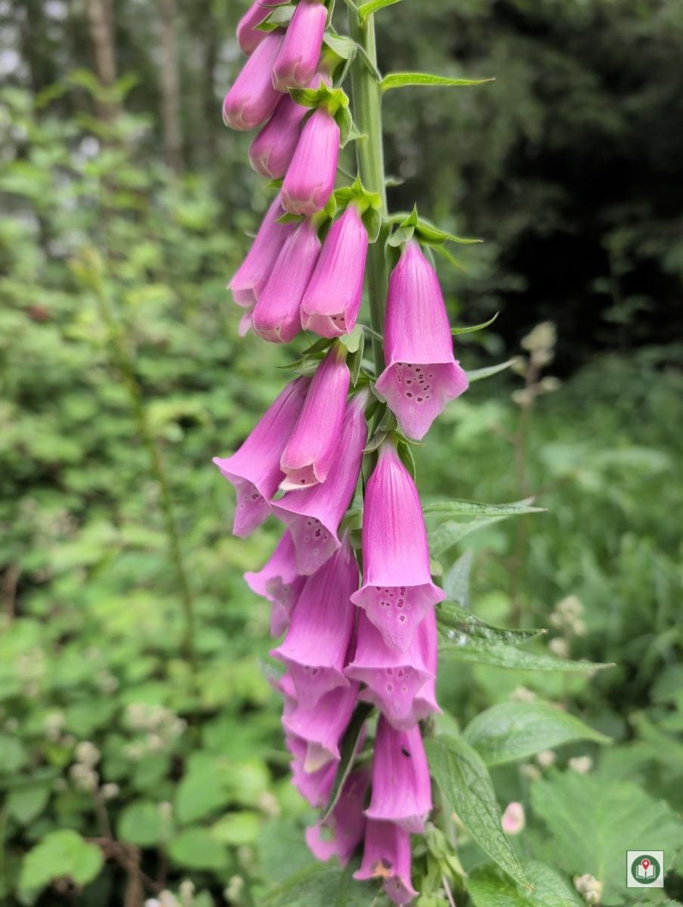
*Fingerhut*

Unser Fazit des Tages, passend um 14:55 Uhr: Die kleinen Dinge machen Freude. Und genau das ist es, was Wandern für uns ausmacht! Dieser Weg ist übrigens nicht nur hundefreundlich, sondern auch familienfreundlich – also packt eure Liebsten ein! Und denkt an ein Trinksystem, Elektrolyte und eine Kopfbedeckung für sonnige Tage. Regenschutz ist ohnehin immer ratsam. Wenn ihr euch stärken wollt, gibt es im Tal Einkehrmöglichkeiten, aber auch ein Picknick in dieser Natur ist unbezahlbar.

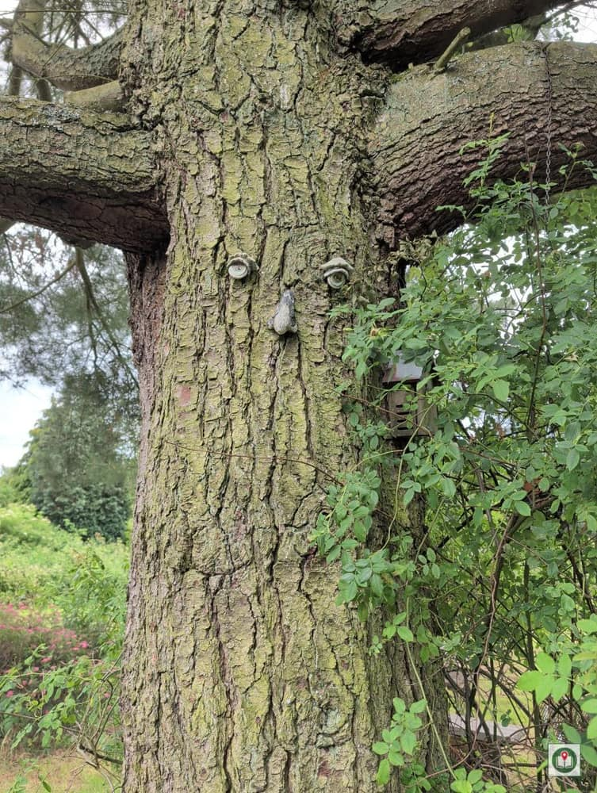
*Die kleinen Dinge machen Freude.*

Was für ein Tag! Das Elbschetal hat uns mit seiner wilden Schönheit und seinen vielen kleinen Entdeckungen verzaubert. Wir können diesen Rundweg uneingeschränkt empfehlen!

Viele Grüße und immer einen vollen Rucksack,\
Mo und Lurt und Hund Möter! 🐾🌲

---

**Wanderstatistik "Elbschetal Rundweg"**

- **Datum:** 14.06.2026
- **Start/Ende:** Im Schleppkotten Wengern
- **Distanz:** ca. 13 km
- **Dauer:** 3 Stunden 30 Minuten
- **Höhenmeter:** 220 m Aufstieg / 220 m Abstieg
- **Schwierigkeit:** Mittel
- **Gelände:** Befestigter Weg, Schotterweg, Waldweg
- **Verpflegung:** Beides (Einkehrmöglichkeiten & Picknick geeignet)
- **Ausrüstungsempfehlung:** Trittsicherheit nötig, Hundefreundlich, Familienfreundlich, Regenschutz ratsam, Trinksystem, Elektrolyte, Kopfbedeckung
- **Wetter:** 16°C, Trocken, Teilweise bewölkt, leichte Brise
