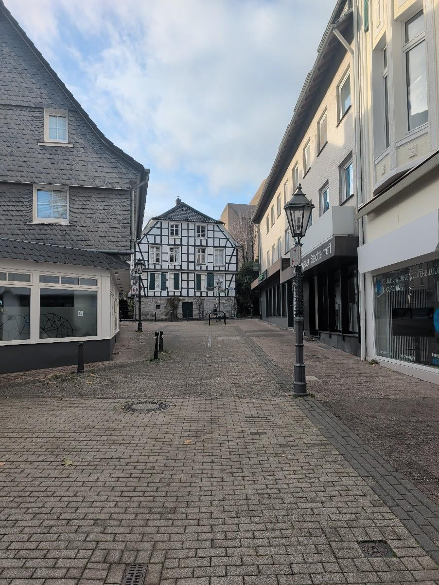
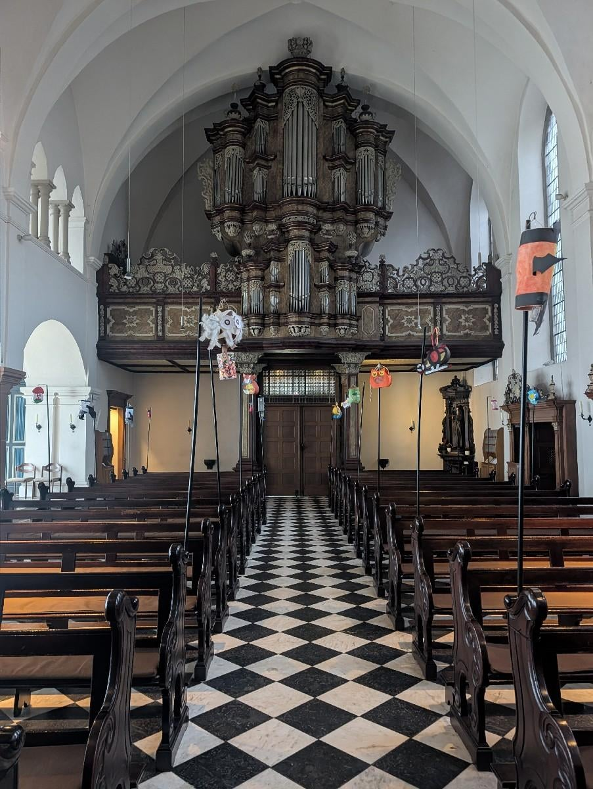
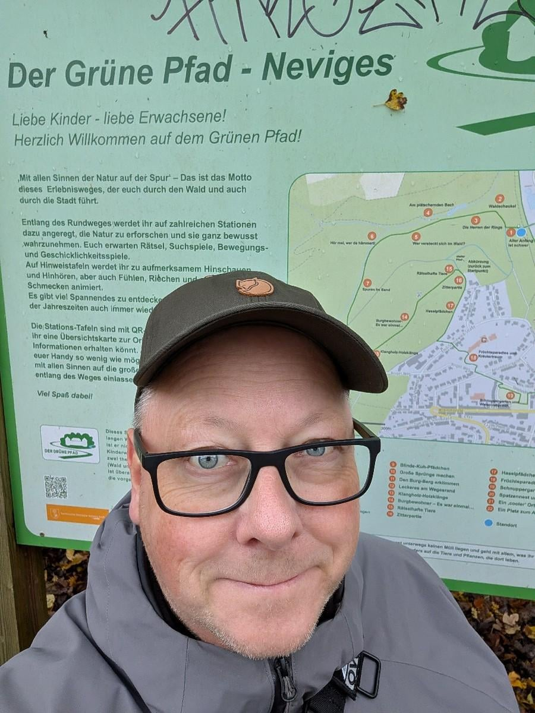
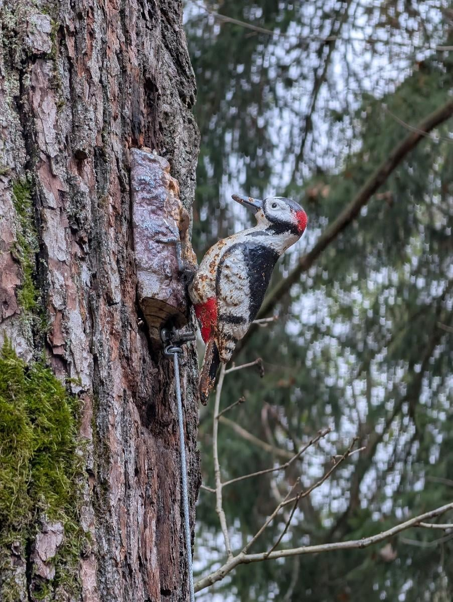
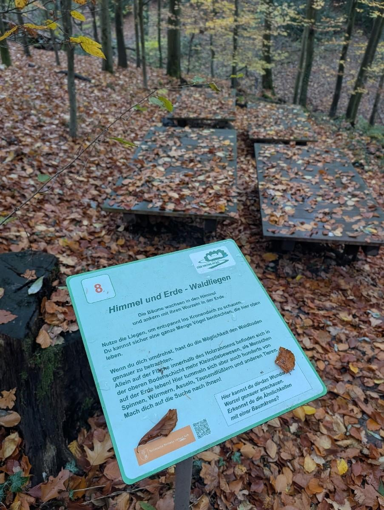
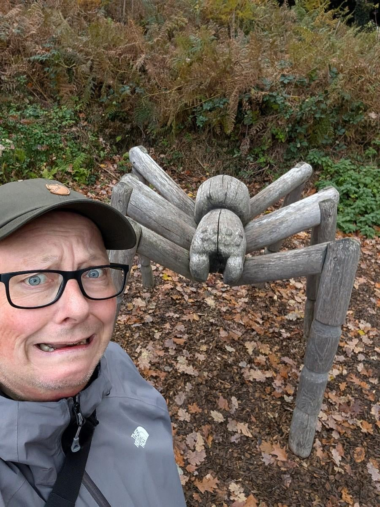
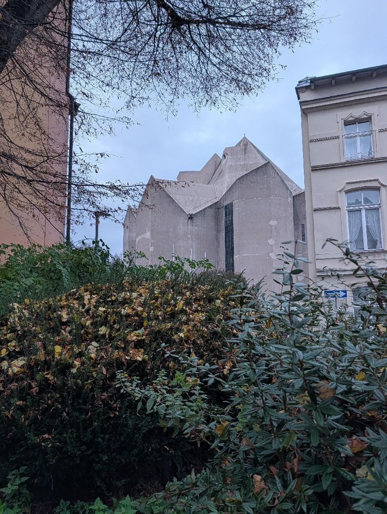
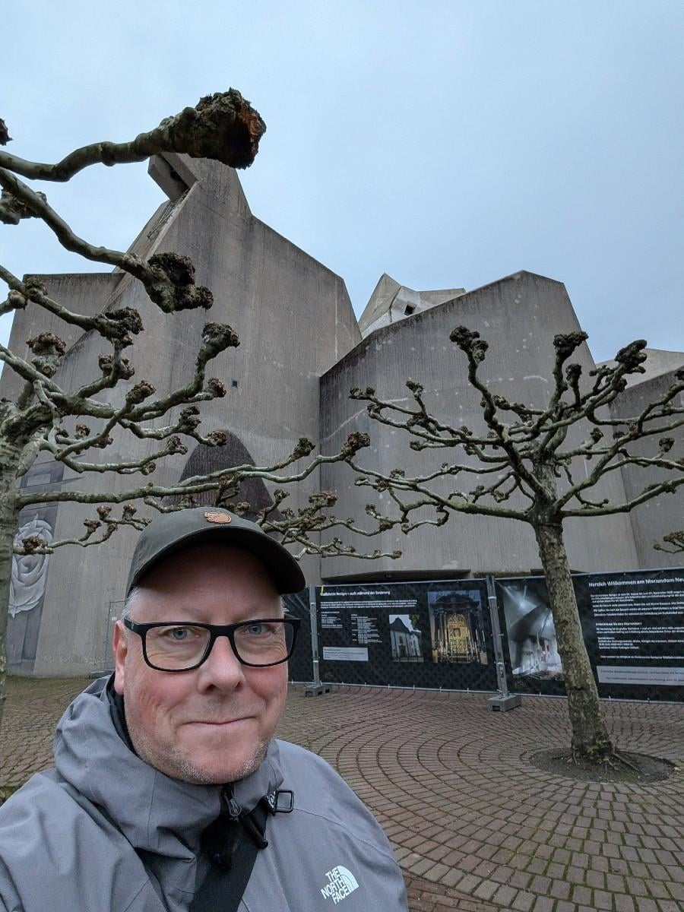
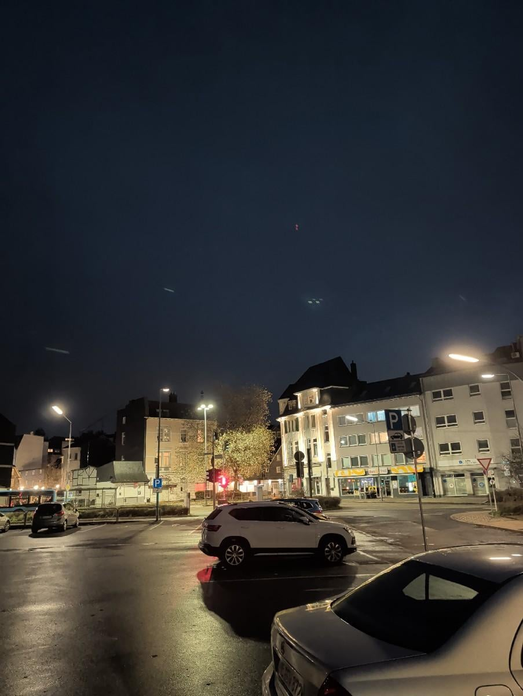

Hallo ihr Lieben! Heute nehmen wir euch mit auf einen wunderbar entspannten Herbstspaziergang. Am 15. November ging es für uns nach Velbert-Neviges auf den Grünen Pfad. Bei kühlen, aber angenehmen 7 Grad, bedecktem Himmel und absoluter Windstille war das Wetter ideal für eine gemütliche Runde ohne Hast. Eine große Verpflegung brauchten wir für die gut vier Kilometer gar nicht einzupacken, genau richtig für einen lockeren Nachmittag an der frischen Luft.

Los ging es am Bahnhof in Neviges. Schon nach wenigen Schritten verzauberte uns die malerische Kulisse der Altstadt.

Wir warfen einen Blick in die stimmungsvolle Pfarrkirche St. Mariä Empfängnis und lauschten kurz dem Klang der Orgel. Vorbei am Alten Bahnhof schlenderten wir weiter zur Infotafel bei der Vorburg Schloss Hardenberg.

Wenig später bogen wir direkt auf den eigentlichen Grünen Pfad ein, wo sich der Naturweg von seiner abwechslungsreichsten Seite zeigte.

Hier reiht sich eine liebevoll gestaltete Station an die nächste. Auf der Waldschaukel ließen wir erst einmal die Seele baumeln und lauschten kurz darauf am Bachlauf dem beruhigenden Plätschern des Wassers. An der Holzspecht-Station konnten wir den Specht sogar selbst klopfen lassen.

Weiter ging es vorbei an Tierspuren im Sand und hübschen Pilzen am Wegesrand. Auf einer bequemen Waldliege legten wir eine kurze Pause ein und blickten entspannt hinauf in die Baumkronen.

Der Spaziergang blieb spielerisch: Wir testeten unsere Sprungkraft, entlockten dem Wald-Xylophon ein paar Töne und meisterten die Zitterpartie an der Spinnen-Station. Das bunte Farbenspiel des Herbstwaldes begleitete uns auf Schritt und Tritt.

Zurück im Ort bewunderten wir noch das schöne Schmuckwerk an den Hausfassaden, bevor sich uns der erste beeindruckende Blick auf den bekannten Mariendom bot.

Ein Erinnerungsfoto von Mo vor dem imposanten Mariendom durfte da natürlich nicht fehlen.

Zum krönenden Abschluss machten wir es uns im gemütlichen Café Wohnzimmer in Neviges bequem. Bei einem Stück Kirschkuchen mit Sahne und einem heißen Cappuccino ließen wir den Ausflug perfekt ausklingen.

Als wir um 17:30 Uhr im leichten Dämmerlicht wieder am Parkplatz anlangten, ging ein rundum gelungener Tag zu Ende.

Bis zum nächsten Mal und bleibt unternehmungslustig!
Euer Mo

## Zahlen zum Spaziergang

- Tour: Der Grüne Pfad Neviges
- Datum: 15.11.2026
- Strecke: ca. 4,6 km
- Dauer: ca. 177 Minuten
- Schwierigkeit: leicht
- Wege: befestigter Weg und Waldweg
- Wetter: 7 °C, bedeckt, trocken, windstill
- Hunde- und familienfreundlich
