Guten Morgen, ihr Lieben! Was für ein herrlicher Tag Ende September! Bei strahlenden 20 Grad, wolkenlosem Himmel und einer sanften, frischen Brise habe ich mich heute auf einen richtig gemütlichen Spaziergang rund um Rüggeberg begeben. Ausgangspunkt war die pittoreske Kirche in Rüggeberg, wo mich direkt das berühmte Wahrzeichen der Region begrüßte: der Rüggeberger Fuchs. Ein perfekter Start für meine kleine Runde!

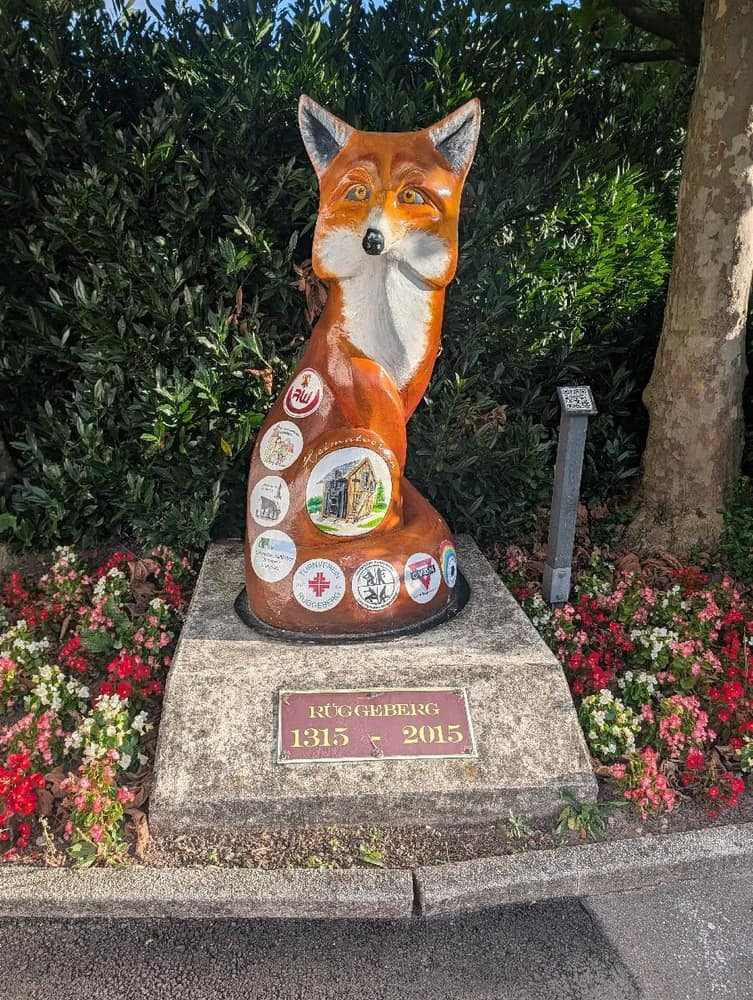
*Wahrzeichen in Ennepetal und Start der Wanderung - der Rüggeberger Fuchs*

Schon nach wenigen Schritten kam ich am historischen Haferkasten vorbei.

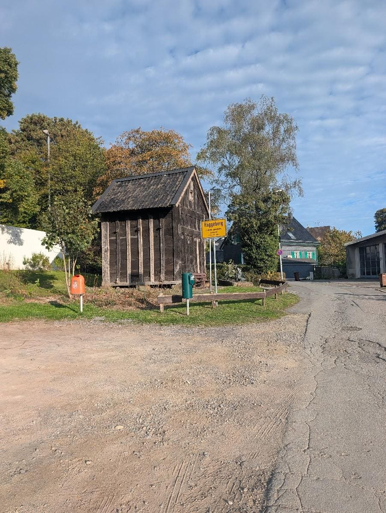
*Haferkasten*

Die Wege hier sind wirklich klasse ausgebaut, absolut trocken und super ausgeschildert. Es macht einfach riesigen Spaß, hier ganz entspannt im eigenen Tempo entlangzuschlängeln.

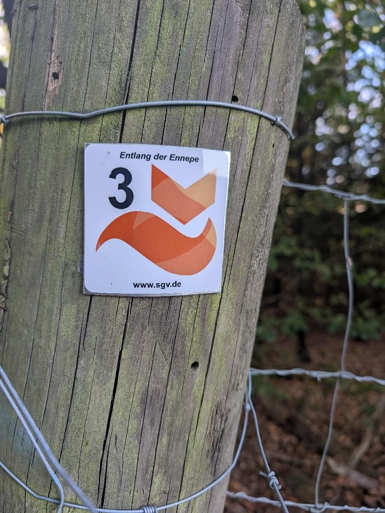
*Viele schöne Wanderwege!*

Unterwegs gab es im Grün am Wegesrand auch gleich schöne botanische Entdeckungen wie eine hübsche Ilex-Pflanze zu bewundern.

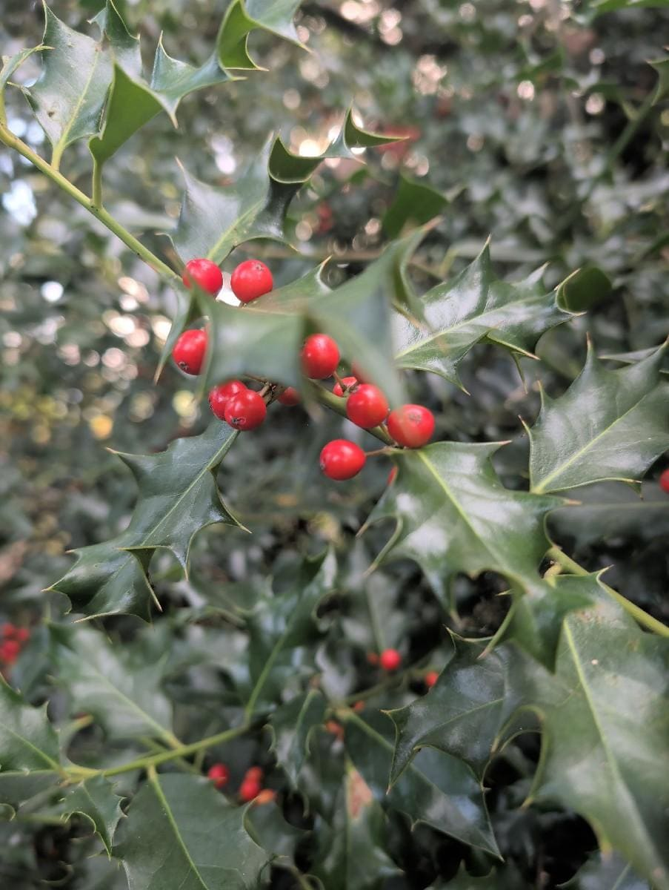
*Ilex*

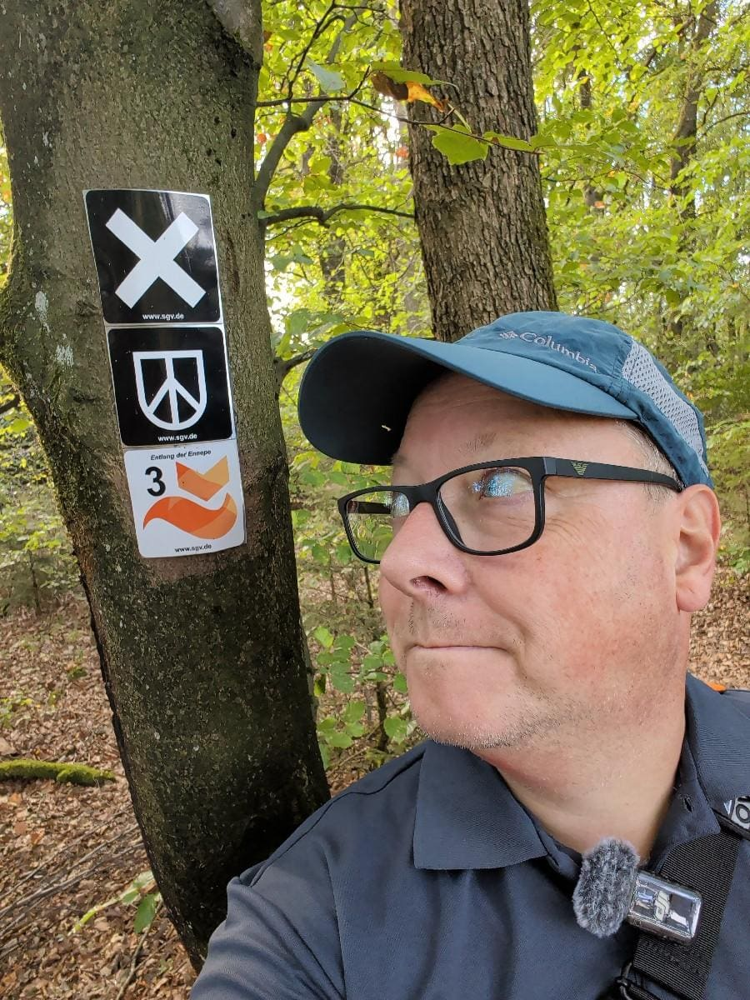
*Super ausgeschilderte Wanderwege*

Ein kleines historisches Highlight ließ nicht lange auf sich warten: Die Bergische Landwehr, die historische Grenze zwischen dem Rheinland und Westfalen. Es ist immer wieder spannend, auf solchen Wegen unterwegs zu sein.

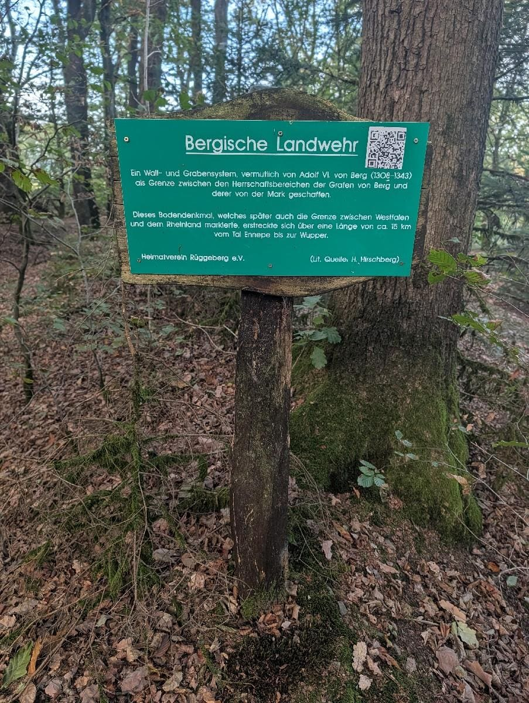
*Die Bergische Landwehr - Grenze zwischen Rheinland und Westfalen.*

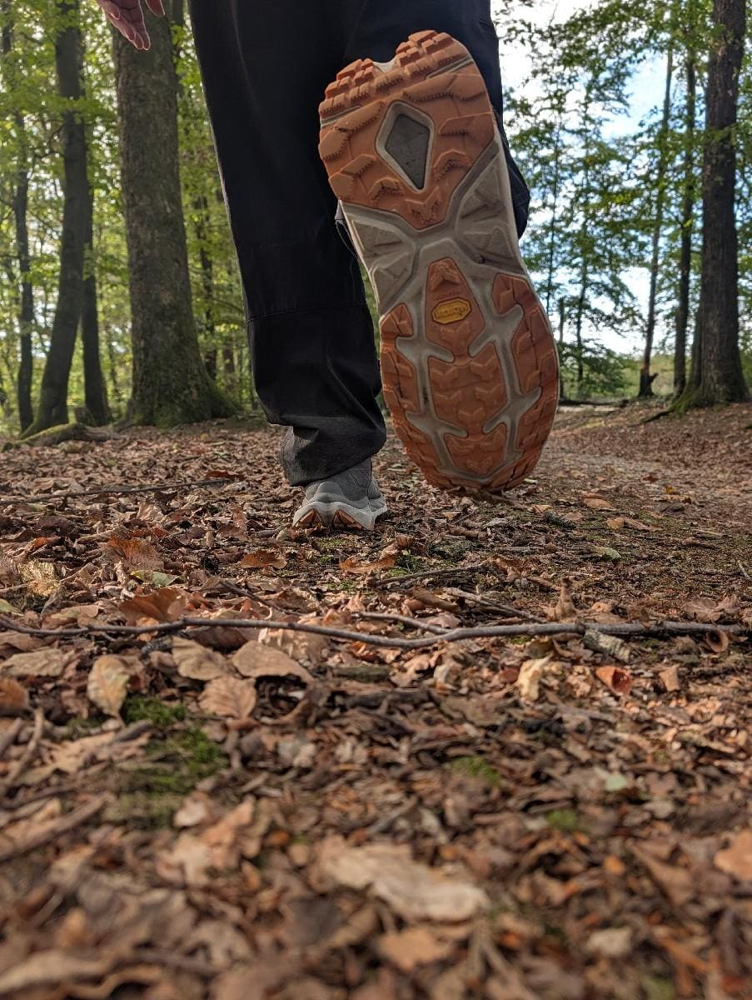
*Trocken und gut zu gehen*

Weiter ging es vorbei am Pilgerweg nach Lennep in Richtung Landhaus Filde.

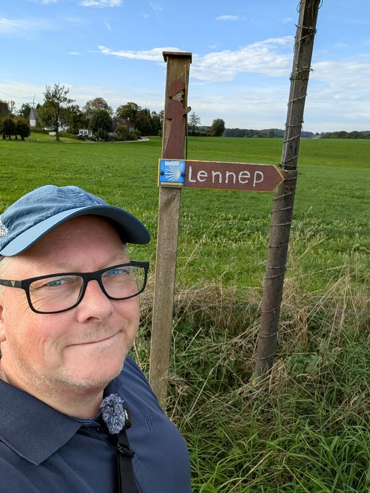
*Pilgerweg nach Lennep*

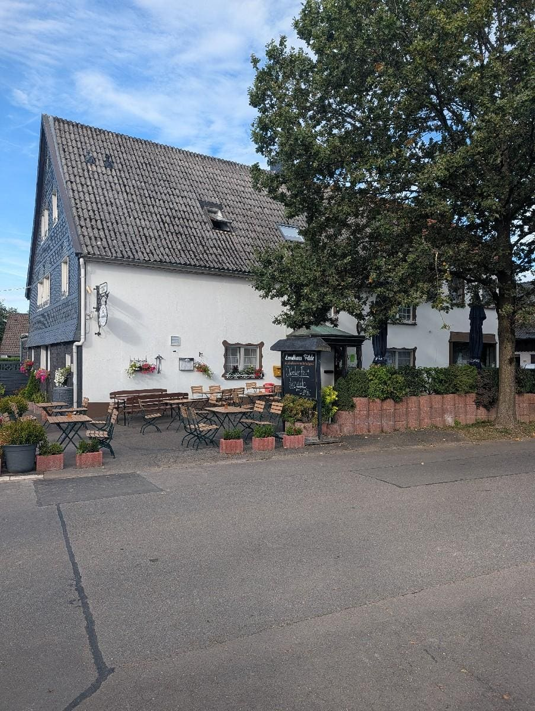
*Landhaus Filde*

Von hier aus hat man einen richtig idyllischen Blick weit ins Klütinger Bachtal hinein. Einfach mal kurz stehen bleiben, tief durchatmen und die Natur genießen – genau so muss eine entspannte kleine Auszeit sein!

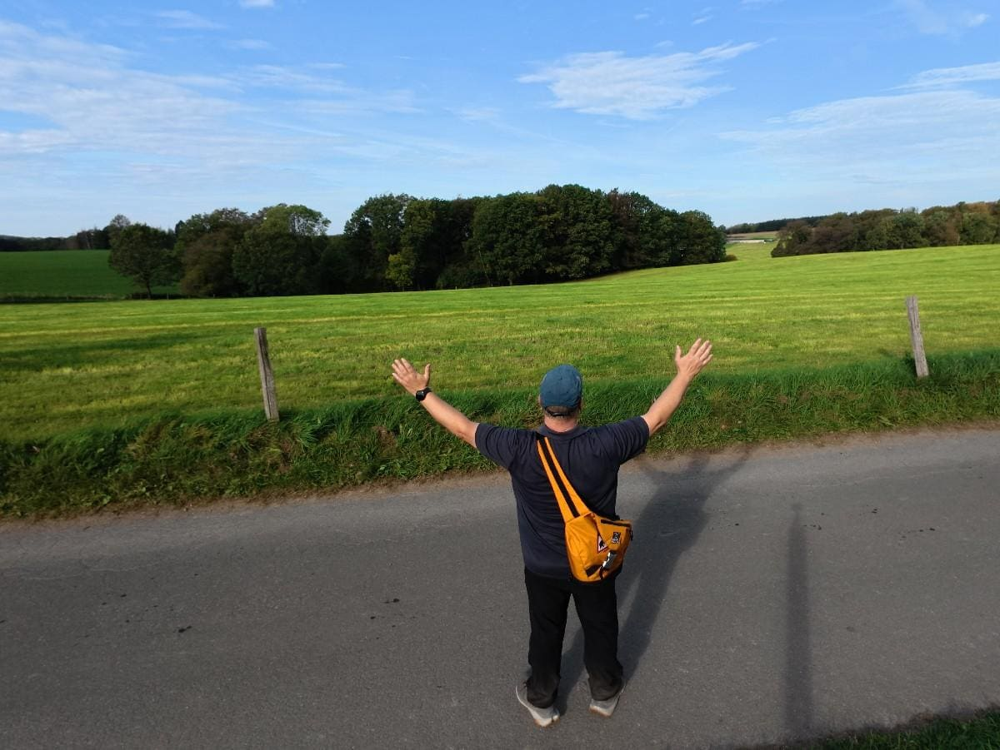
*Blick ins Klütinger Bachtal*

Auf dem Rückweg leuchteten mir auf dem Waldweg plötzlich strahlend rote Fliegenpilze entgegen – ein richtiger Hingucker im Moos!

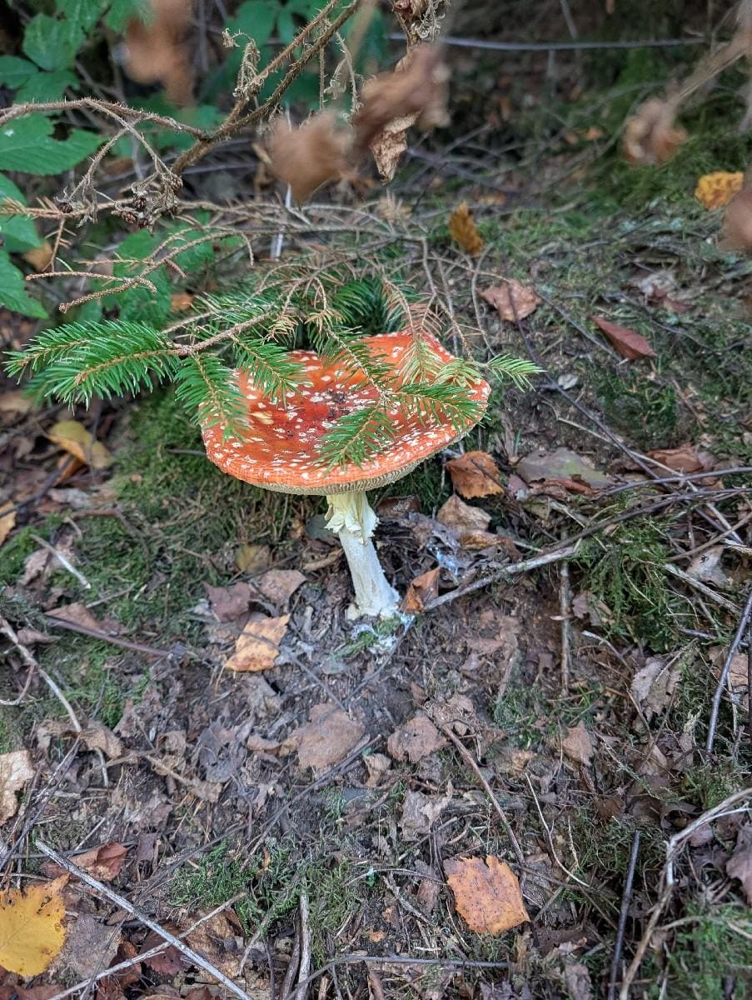
*Fliegenpilze*

Ein paar Meter weiter entdeckte ich dann noch eine wunderschöne Glanz-Kastanie. Die habe ich natürlich sofort als kleines Mitbringsel für Ursel eingesteckt.

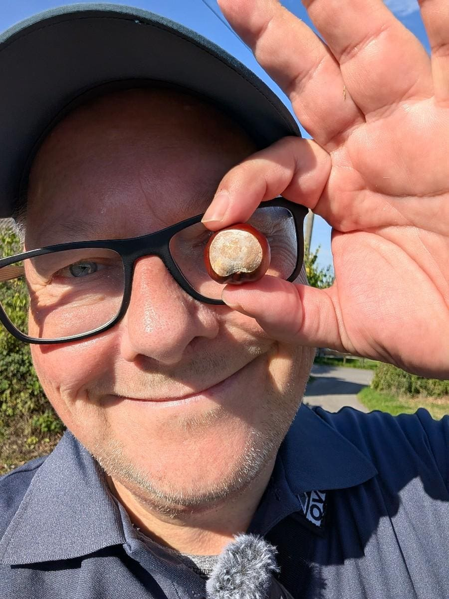
*Ein Mitbringsel für Ursel - eine Kastanie*

Nach knapp gut zweieinhalb Stunden Schlendern erreichte ich schließlich wieder das beschauliche Rüggeberg.

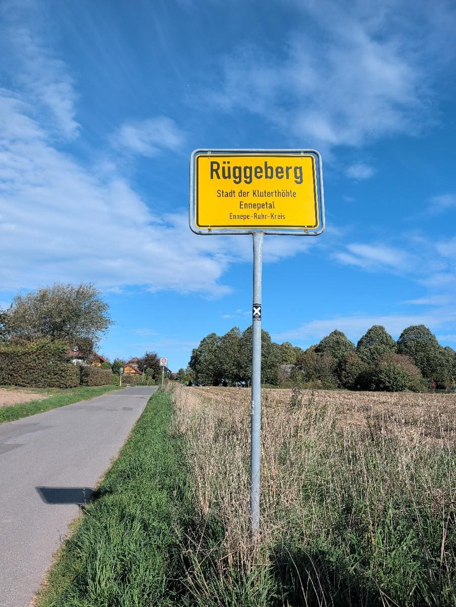
*Zieleinlauf Rüggeberg*

Am Ziel ging es nochmal vorbei an der Wandertafel und dem treuen Fuchs.

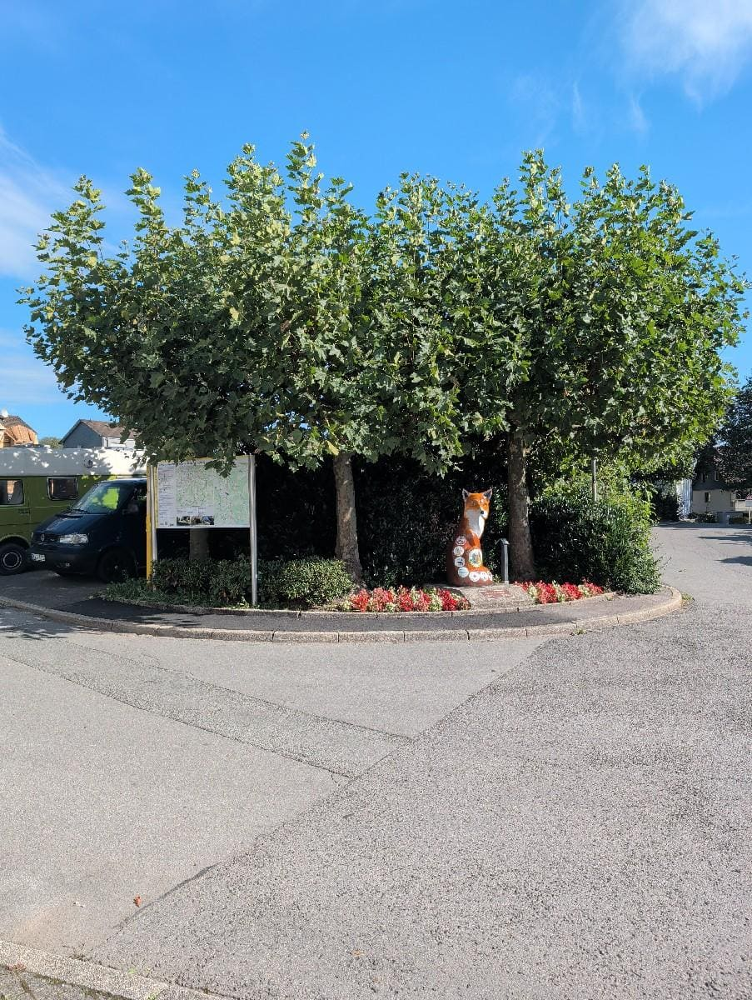
*Ziel Wandertafel und Fuchs*

Und das Beste kommt bekanntlich zum Schluss: Nach dieser wunderbaren Runde gönnen Ursel und ich uns jetzt erst einmal ein richtig leckeres Eis!

*Jetzt gibt's für Ursel und mich noch ein leckeres Eis*

Bleibt entspannt und genießt die sonnigen Momente vor der eigenen Haustür!

Viele Grüße, euer Mo! 🍦🍁

---

**Tour-Statistik:**

- Route: Klutert Wandern Grenzgang Rüggeberg-Filde (Rundweg)
- Start / Ziel: Kirche Rüggeberg
- Datum: 30.09.2026
- Strecke: ca. 6,3 km
- Dauer: ca. 155 Minuten
- Schwierigkeit: Leicht (hundefreundliche und familienfreundliche Wegstrecke)
- Wegbeschaffenheit: Befestigter Weg, Waldweg
- Wetter: Trocken, 20°C, wolkenlos, angenehme Brise
- Einkehr: Landhaus Filde / Gasthaus vorhanden
